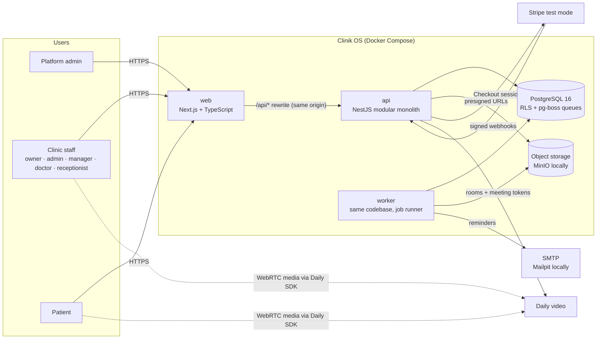
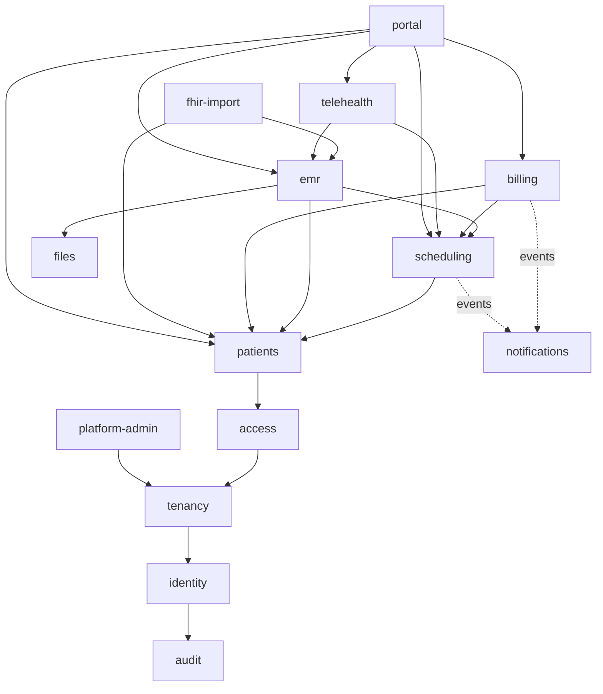
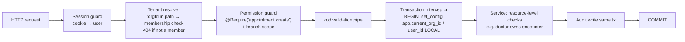
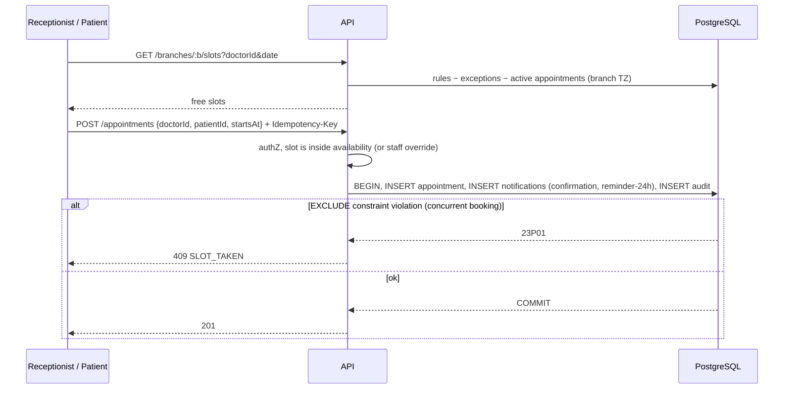
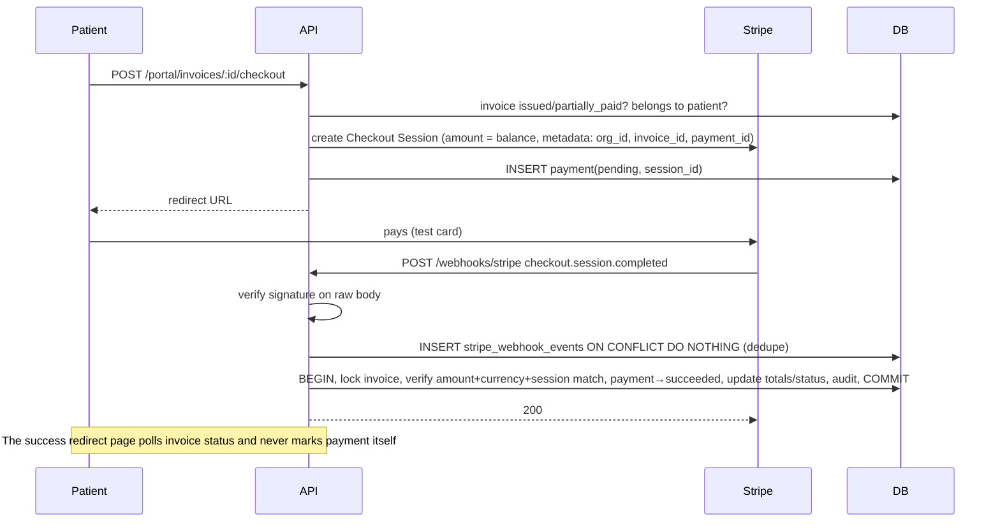
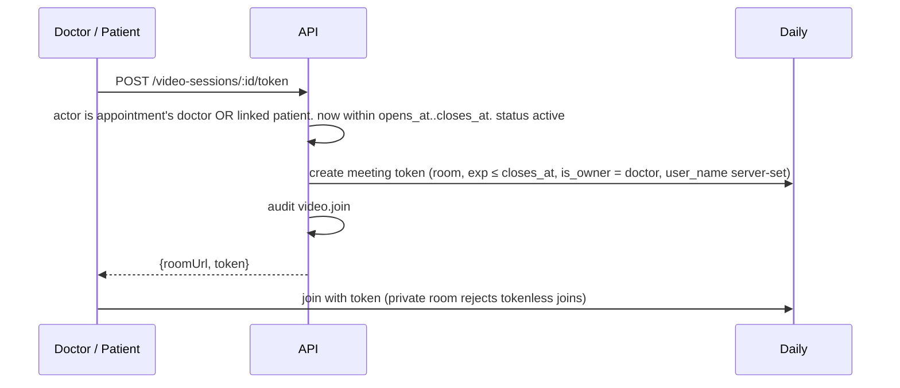
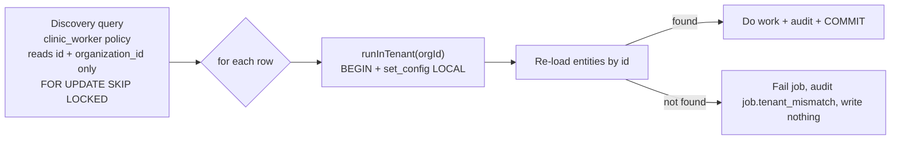
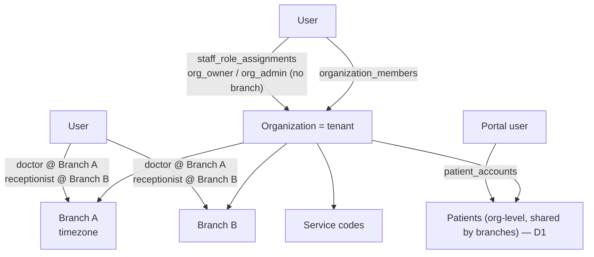

# Architecture — Clinik OS

Status: **approved design, v1.2. No implementation yet.** v1.2 is a controlled simplification (D11r, D18–D25, §11.1). It keeps every feature in the brief and all seven roles, and removes implementation machinery the brief doesn't need: GST, gapless numbering, duplicate relinking, the import pipeline, five triggers and most worker jobs. **Acceptance = the six demo workflows plus the security suites** (DEVELOPMENT_ROADMAP §0).
Companion docs: [DATABASE_DESIGN.md](DATABASE_DESIGN.md) · [RBAC_MATRIX.md](RBAC_MATRIX.md) · [DEVELOPMENT_ROADMAP.md](DEVELOPMENT_ROADMAP.md)

Source requirements: project `context`, `instruction`, `dataset` docs. Anything not stated there is marked **Assumption (A#)** or **Decision (D#)**. §11 lists them all, with their status.

---

## 1. Summary

A **modular monolith**: one NestJS API process, one worker process (same codebase, different entrypoint), one Next.js web app, and PostgreSQL. External services are Stripe (test mode), Daily (video), SMTP (email) and S3-compatible storage.

Key architectural bets:

| Decision | Choice | Why |
|---|---|---|
| Deployment shape | Modular monolith, 2 processes (api, worker) | Required by context. One DB transaction can span modules, which is what makes "no double booking" and "invoice + payment consistency" cheap |
| Tenant isolation | Shared schema, `organization_id` on every row, **composite FKs + RLS + app guards** | Three independent layers. A single bug doesn't leak data |
| Double booking | PostgreSQL `EXCLUDE` constraint | Race-free under concurrency. App checks alone are not |
| Background jobs | **pg-boss (Postgres-backed)**. **No Redis and no microservices in the MVP** (decided) | One fewer moving part. Redis would only be reconsidered for multi-instance scaling after the MVP |
| Auth | Server-side sessions, opaque httpOnly cookie | Revocable immediately, no JWT refresh complexity |
| Web ↔ API | Next.js rewrites `/api/*` to NestJS (same origin) | No CORS. Cookies stay first-party |
| Video | Daily, Prebuilt UI embedded in our page | Short-lived meeting tokens. We don't build WebRTC signaling |
| Payments | Stripe Checkout (hosted) + webhooks | Card data never touches our servers |
| ORM | Drizzle (alternative: Kysely) | Explicit transactions make `SET LOCAL` per request straightforward. Prisma + RLS is workable but awkward |

---

## 2. System context



### Frontend / backend boundary

| Concern | Frontend (Next.js) | Backend (NestJS) |
|---|---|---|
| Authorization | Hides UI the user can't use (UX only) | **Sole authority.** Every request re-checked |
| Validation | Same zod schemas for form UX | Authoritative zod validation + DB constraints |
| Business rules | None | All (slot calculation, totals, state transitions) |
| Data access | Only via `/api/v1` | Only the backend talks to Postgres, Stripe secret API and Daily REST |
| Secrets | None (only Stripe publishable key, Daily room URL) | All secrets |
| Rendering | Next.js used as a client-heavy app. Server Components only for layout/shell. **No server actions that touch data** | — |

---

## 3. Modules

### 3.1 Module catalogue

| Module | Responsibility | Owns tables | Depends on |
|---|---|---|---|
| `identity` | Registration, login, sessions, password reset, email verification | users, sessions, auth_tokens | audit |
| `tenancy` | Organizations, branches, membership, invitations, role assignments, tenant context | organizations, branches, organization_members, staff_role_assignments, invitations | identity, audit |
| `access` | Permission catalogue, policy evaluation (`can(actor, action, resource)`), guards | — (reads tenancy) | tenancy |
| `patients` | Patient registry, duplicate warning (query), staff verification, portal account linking, insurance policies | patients, patient_accounts, insurance_policies | tenancy, access |
| `scheduling` | Doctor profiles, availability, slot computation, appointments, series | doctors, availability_rules, availability_exceptions, appointment_series, appointments | patients, tenancy |
| `notifications` | Outbox, templates, email delivery, reminder scheduling | notifications | — (consumes events) |
| `emr` | Encounters, SOAP, patient summaries, diagnoses, allergies, prescriptions, labs, observations | encounters, soap_notes, diagnoses, allergies, prescriptions, prescription_items, lab_orders, lab_order_tests, observations | patients, scheduling, files |
| `files` | Upload/download via presigned URLs, metadata | files | — |
| `fhir-import` | Synthea FHIR R4 mapping used by the `pnpm seed:synthea` CLI (D18). No HTTP endpoints | — | patients, emr |
| `billing` | Service codes, invoices (no tax, D11r), claims, manual payments, Stripe Checkout + webhooks | service_codes, invoices, invoice_items, insurance_claims, payments, stripe_webhook_events | patients, scheduling |
| `telehealth` | Video sessions, Daily rooms and tokens, in-call chat | video_sessions, consultation_messages | scheduling, emr (read/draft) |
| `portal` | Patient-facing API facade (no tables). Composes other modules with patient-scoped policies | — | patients, scheduling, emr, billing, telehealth |
| `platform-admin` | Organization provisioning and suspension | — (uses tenancy) | tenancy |
| `audit` | Append-only audit writer and audit queries | audit_logs | — |
| `core/idempotency` (cross-cutting) | `Idempotency-Key` handling for booking and checkout (D23) | idempotency_keys | — |
| `core/jobs` (cross-cutting) | pg-boss wiring, `runInTenant`, discovery queries | — (pg-boss schema) | — |

### 3.2 Dependency direction



### 3.3 Communication rules

1. **Synchronous, in-process calls through a module's public service** (`modules/<m>/index.ts` exports). No module imports another module's repository or table schema. Enforced by `dependency-cruiser` in CI.
2. **One DB transaction per request.** Cross-module writes, such as completing an appointment and creating a draft invoice, share it through a request-scoped transaction context.
3. **Domain events** (`appointment.booked`, `appointment.rescheduled`, `appointment.cancelled`, `invoice.issued`, `payment.succeeded`, `lab.results_released`) go on an in-process bus. Handlers run **inside the same transaction** and may only write rows, for example insert `notifications` or enqueue a pg-boss job in the same transaction.
4. **No external HTTP call inside a DB transaction.** Calls to Stripe, Daily and SMTP happen either before the transaction (create a Checkout session, then persist) or in the worker.
5. No cycles. `portal` is a leaf facade, so patient-facing rules (what a patient may see) live in one place.
6. No new deployable services. Everything is a module of the one codebase, run as the `api` or `worker` process.

### 3.4 Request pipeline



### 3.5 Key flows

**Booking (staff or portal)**



**Online payment**



**Video join**



### 3.6 Background jobs and tenant isolation

The worker is the same codebase run with `worker.ts`. It connects as **`clinic_worker`**, a separate DB role with explicit grants. It has no access to `users`, `sessions`, `organizations`, SOAP notes or invoices.

| Job | Trigger | Discovery (cross-tenant) | Work (inside tenant context) |
|---|---|---|---|
| Send notification (**the only job in the MVP**, D22) | every 30 s | due `pending` notifications | render template from ids, send via SMTP, mark sent/failed |

Removed in v1.2, with what replaced them:
- *Synthea import job* → the `pnpm seed:synthea` CLI (D18).
- *Video room cleanup* → rooms are created with Daily `exp = closes_at` and `eject_at_room_exp = true`. Daily blocks joins after `exp` and the room stops counting against limits.
- *Idempotency key expiry* → expired keys are overwritten lazily on reuse.

The worker **infrastructure stays**: the separate process, pg-boss on Postgres, `runInTenant`, the `clinic_worker` role and fail-closed RLS. Adding a job later needs no new machinery.



Stripe webhook failures are **not** a worker job. The handler returns 5xx and Stripe redelivers, and the handler is idempotent. This keeps `clinic_worker` away from payment tables.

Rules:
1. Job payloads are `{ orgId, entityIds }`. No PHI in pg-boss tables.
2. `runInTenant` is the only DB entry point for job code (lint-enforced). Context is transaction-local, so nothing leaks to the next job on a pooled connection.
3. Discovery policies expose job-control rows only. Column-level UPDATE grants stop the worker changing `organization_id` or recipients. PostgreSQL also requires an updated row to stay visible under SELECT policies, so real state changes are only possible inside the tenant context. This was verified (DATABASE_DESIGN §13, W1–W4).
4. External calls (SMTP, Daily) happen after the row is claimed and outside the DB transaction. Results are written in a second short transaction.

### 3.7 External integrations

| Service | Use | Local dev | Failure behaviour |
|---|---|---|---|
| Stripe | Checkout sessions, webhooks (test mode only) | Stripe CLI `stripe listen --forward-to` | Checkout create fails, so the user retries. Webhooks are retried by Stripe and the handler is idempotent |
| Daily | Private rooms per appointment, meeting tokens, Prebuilt UI | Daily free dev account | Token endpoint returns 503. The appointment can be converted to in-person or rescheduled |
| SMTP | Confirmations, reminders, invitations, password reset | Mailpit container | Worker retries with backoff (max 5). Status visible in `notifications` |
| S3 API | Lab reports and clinical attachments | MinIO container | Upload fails cleanly. DB row remains `pending_upload` and is garbage-collected |
| Synthea | Synthetic FHIR R4 bundles, loaded by `pnpm seed:synthea --org <slug> <dir>` | `/seed/synthea/*.json` | Per-bundle transaction. Failed bundles listed in the CLI summary. Re-runs are no-ops |

---

## 4. Multi-tenant architecture

### 4.1 Model



- **Organization** = tenant boundary. Everything clinical or financial carries `organization_id`.
- **Branch** belongs to exactly one organization, with its own timezone. Appointments, invoices and availability are branch-scoped *within* the tenant.
- **Users** are global identities (one email). Staff join orgs through `organization_members` and get roles through `staff_role_assignments`: org-level roles have no branch, branch-level roles name one branch, and one row per branch. Patients link through `patient_accounts`, and one user can be a patient at several orgs.
- **Platform admin** is a flag on `users`, outside any tenant.

### 4.2 How isolation is enforced (defence in depth)

| Layer | Mechanism | Catches |
|---|---|---|
| L1 Routing | Tenant in URL path `/api/v1/orgs/:orgId/...`. The resolver loads membership and returns **404** for non-members, so a tenant's existence isn't revealed | Wrong-org requests |
| L2 Authorization | Permission guard + branch scope + resource rules (RBAC_MATRIX) | Wrong role or branch inside the right org |
| L3 Query scoping | Repositories take `TenantContext` and always add `organization_id = ctx.orgId` | Missing filter in hand-written queries |
| L4 Composite FKs | `(organization_id, x_id) → parent(organization_id, id)` | Writes that link rows across tenants (IDOR on writes) |
| L5 RLS | `organization_id = app_current_org()` with `FORCE`, a non-owner app role, and `SET LOCAL` per transaction | Any L1–L3 bug on reads/writes. **Fails closed** when context is missing |

### 4.3 Is PostgreSQL RLS appropriate?

**Yes, as a safety net. It is not the primary authorization mechanism.**

- It handles **tenant** isolation only (a single uniform policy). Branch and role rules stay in the app, where they are testable and give readable errors. Encoding RBAC in policies would be hard to debug and slow.
- It is verified in a scratch DB: no context gives 0 rows, a cross-tenant insert is rejected, and context clears at transaction end.
- Requirements and pitfalls:
  - The app must connect as a role that is **not the table owner and has no `BYPASSRLS`**. Migrations use a separate owner role.
  - **Only `set_config(..., true)` (transaction-local)**, never session-level `SET`, because pooled connections would carry the previous tenant.
  - Every query must run inside the request transaction. The transaction interceptor is mandatory on all tenant routes. A lint/test asserts it.
  - Cross-tenant system work (worker polling due notifications) uses narrow role-specific policies, then switches into the row's tenant context.
  - Cost: small planner overhead. The indexes already lead with `organization_id`.

### 4.4 Cross-tenant leakage scenarios

| # | Scenario | Mitigation |
|---|---|---|
| X1 | IDOR: `GET /orgs/A/patients/<id of org B patient>` | L3 filter + L5 RLS → 404 |
| X2 | Write linking another tenant's row (book Org B patient in Org A) | L4 composite FK (tested) |
| X3 | User is a member of A and B and sends `orgId=B` with a token from A | Membership checked per request against path `orgId`. Sessions are not tenant-bound |
| X4 | Pooled connection retains previous tenant's `SET` | Transaction-local config only (tested) |
| X5 | Background job runs without tenant context, or with the wrong one | §3.6 protocol. Separate `clinic_worker` role. Entities re-loaded by id inside context. RLS fails closed. Tests W1–W4 |
| X6 | Global search / autocomplete / reports aggregate across tenants | All go through tenant repos. No raw SQL outside repositories (lint) |
| X7 | Object storage key guessing, long-lived URLs | Keys `orgId/fileId` (server-generated). AuthZ before signing. URL TTL 5 min. Bucket private |
| X8 | Stripe webhook trusts `metadata.org_id` | Metadata is used only to locate the row. Amount, currency and session id are re-verified from the DB |
| X9 | Video room reuse / token for another appointment | One room per appointment, random name, tokens bound to room + expiry |
| X10 | Portal user with records in A and B sees both in one org view | Portal endpoints are scoped by `patientId` that must exist in `patient_accounts` for the user, plus org context |
| X11 | Email reminders sent to the wrong patient or containing PHI | Recipient resolved inside tenant context. Templates carry date/time/branch only, no diagnoses |
| X12 | Platform admin tooling bypasses RLS | Platform admin endpoints touch only `organizations` / non-PHI tables (A4) |
| X13 | Error messages / unique violations reveal existence (`email already exists in org B`) | Generic errors on auth and registration. Constraint names mapped to neutral messages |
| X14 | Caches keyed without tenant (if Redis is added later) | Key convention `t:<orgId>:...` mandated now |
| X15 | Seed CLI writes into the wrong org | The org slug is an explicit CLI argument. Each bundle runs in `runInTenant(orgId)` as `clinic_app`, so RLS rejects cross-org rows (tested) |
| X16 | Portal self-registration reveals that a person is already a patient (duplicate warning) | Identical response whether or not a match exists. Matches are shown to staff only |
| X17 | Idempotency key replays another user's response | Key scoped by `(organization_id, user_id, key)`. Request hash must match, otherwise 422 |

---

## 5. Authorization model (summary)

Full matrix in [RBAC_MATRIX.md](RBAC_MATRIX.md).

- **Permissions** are code constants (`patient.read`, `soap_note.sign`, …). **Roles** map to permission sets in code (`packages/shared/src/rbac.ts`), not in the DB, so they are versioned, reviewed and tested. Custom roles are out of scope.
- **Evaluation:** `allowed = ∃ role assignment r of actor in org such that permission ∈ r.permissions AND scope(r) covers resource`.
  - Org roles cover all branches. Branch roles cover `resource.branch_id ∈ assigned branches`.
  - **Own** rules are checked in the service: doctor = `encounter.doctor_id`, patient = `patient_accounts`.
- **Clinical content** (SOAP, diagnoses, prescriptions, labs) requires the `doctor` role (**D3**). Holding `org_owner` or `org_admin` alone does not grant it. An owner who treats patients gets a doctor assignment.
- **Doctor read scope (D2, MVP):** any doctor in the organization may read any patient's clinical record in that organization. The compensating control is that **every clinical record access is audited**:

  | Audited read action | Endpoint(s) |
  |---|---|
  | `chart.read` | `GET /patients/:id/chart` |
  | `encounter.read`, `soap_note.read`, `soap_note.versions.read` | encounter and SOAP endpoints |
  | `prescription.read`, `lab_result.read`, `observation.read`, `diagnosis.read`, `allergy.read` | list/detail endpoints |
  | `file.download` | presigned download |
  | `telehealth.chart_panel.read` | in-call chart panel |
  | `portal.record.read` | patient reading their own visits, prescriptions or labs |

  Each row records actor, roles, patient_id, resource, request id and outcome (including denials). Owners and admins can view "who accessed this patient".
- **Future restriction (post-MVP, documented, not built).** The scope check lives in one function, `access.canReadClinicalRecord(actor, patient)`, so narrowing it is a localized change. Candidate rules:
  1. *Treating relationship:* the doctor has or had an appointment or encounter with the patient, or is named on a care-team assignment.
  2. *Authorized branches:* the patient has an appointment, encounter or `preferred_branch_id` at one of the doctor's branches.
  3. Either rule plus **break-glass**: time-boxed access with a mandatory reason, a high-visibility audit event and owner notification.

  Schema impact is small: rule 1 needs at most a `care_team_members` table, and rule 2 needs none.

---

## 6. API architecture

### 6.1 Conventions

- REST + JSON, base `/api/v1`. OpenAPI generated from zod schemas, served at `/api/docs` in dev.
- Staff routes: `/api/v1/orgs/:orgId/...`. Patient routes: `/api/v1/portal/...`. Platform: `/api/v1/admin/...`. Webhooks: `/api/v1/webhooks/...`.
- Errors: RFC 9457 `application/problem+json` with a stable `code` (`SLOT_TAKEN`, `INVOICE_NOT_EDITABLE`).
- Pagination: cursor (`?cursor=&limit≤100`). Filtering by explicit query params, no generic filter DSL.
- Concurrency: `version` field + `If-Match` on reschedule and invoice edit gives 409 on a stale write.
- Idempotency (D23): `Idempotency-Key` header required on **booking and checkout only**: `POST /appointments`, `POST /portal/profiles/:id/appointments` and `POST /portal/invoices/:id/checkout`. Stored in `idempotency_keys` in the same transaction as the operation, for 24 h. A retry replays the stored response. The same key with a different body returns 422. For Checkout, the key is forwarded to Stripe as its idempotency key. **Stripe webhook replay protection is separate** and always on (`stripe_webhook_events.event_id`).
- State changes are explicit action endpoints (`POST /invoices/:id/issue`), not `PATCH status`.

### 6.2 Endpoints

**Auth & identity** (`/api/v1/auth`)

| Method | Path | Notes |
|---|---|---|
| POST | /auth/login | rate-limited. Sets session cookie |
| POST | /auth/logout | revokes session |
| GET | /auth/me | user + memberships + roles + linked patient profiles |
| POST | /auth/password/forgot · /auth/password/reset | generic response, no account enumeration |
| POST | /auth/email/verify | |
| GET | /auth/invitations/:token | preview (org name, role) |
| POST | /auth/invitations/:token/accept | set password, create membership/role or patient link |
| GET · DELETE | /auth/sessions · /auth/sessions/:id | list and revoke own sessions |

**Platform admin** (`/api/v1/admin`): `GET/POST /organizations`, `GET/PATCH /organizations/:id`, `POST /organizations/:id/suspend|reactivate`, `POST /organizations/:id/owner-invitation`.

**Organization administration** (`/api/v1/orgs/:orgId`)

| Method | Path |
|---|---|
| GET · PATCH | / (org settings) |
| GET · POST | /branches |
| GET · PATCH | /branches/:branchId |
| GET | /members |
| POST · DELETE | /invitations · /invitations/:id |
| PUT | /members/:userId/roles (replace assignment set, with validation of who may grant what) |
| DELETE | /members/:userId |
| POST | /ownership-transfer |
| GET | /audit-logs?patientId&actorId&from&to |

**Doctors & availability**

| Method | Path |
|---|---|
| GET · POST | /doctors |
| GET · PATCH | /doctors/:doctorId |
| GET · PUT | /doctors/:doctorId/availability-rules (replace weekly template) |
| GET · POST · DELETE | /doctors/:doctorId/availability-exceptions[/:id] |
| GET | /branches/:branchId/slots?doctorId&from&to&mode |

**Patients**

| Method | Path |
|---|---|
| GET | /patients?q&dob&verification=pending&cursor (search; verification queue) |
| POST | /patients (409 `POSSIBLE_DUPLICATE` with matches unless `acknowledgeDuplicates=true`) |
| GET | /patients/:patientId/possible-duplicates (computed on request) |
| POST | /patients/:patientId/verify |
| POST | /patients/:patientId/mark-duplicate `{ existingPatientId, reason }` (sets this record `inactive`. No relink, no merge, D19) |
| GET · PATCH | /patients/:patientId (demographics) |
| POST | /patients/:patientId/portal-invitation |
| GET · POST · PATCH | /patients/:patientId/insurance-policies[/:id] |

**Appointments**

| Method | Path |
|---|---|
| GET | /appointments?branchId&doctorId&patientId&from&to&status |
| POST | /appointments |
| GET | /appointments/:id |
| POST | /appointments/:id/reschedule · /cancel · /confirm · /check-in · /no-show · /complete |
| POST | /appointment-series (all-or-nothing, 409 lists conflicts) |
| POST | /appointment-series/:id/cancel?scope=future |

**Medical records**

| Method | Path |
|---|---|
| GET | /patients/:patientId/chart (summary: problems, allergies, active meds, recent labs, encounters) |
| GET | /patients/:patientId/encounters · /observations?category · /prescriptions · /lab-orders |
| POST | /appointments/:id/encounter (open encounter from appointment) |
| GET | /encounters/:id |
| POST | /encounters/:id/close |
| PUT | /encounters/:id/patient-summary (doctor-written, patient-facing) |
| POST | /encounters/:id/patient-summary/release |
| PUT | /encounters/:id/soap-note (save draft) |
| POST | /encounters/:id/soap-note/sign · /soap-note/amend |
| GET | /encounters/:id/soap-note/versions |
| POST · PATCH | /patients/:patientId/diagnoses[/:id] · /allergies[/:id] |
| POST | /encounters/:id/prescriptions (draft) |
| PATCH | /prescriptions/:id (draft only) |
| POST | /prescriptions/:id/sign · /cancel |
| POST | /encounters/:id/lab-orders |
| POST | /lab-orders/:id/collect · /results (observations + optional fileId) · /release |
| POST | /files (returns presigned PUT) · /files/:id/complete |
| GET | /files/:id/download (presigned GET, 5 min) |

**Billing**

| Method | Path |
|---|---|
| GET · POST · PATCH | /service-codes[/:id] |
| GET · POST | /invoices (POST creates draft, optionally from appointmentId) |
| GET · PATCH · DELETE | /invoices/:id (draft only for PATCH/DELETE) |
| PUT | /invoices/:id/items |
| POST | /invoices/:id/issue · /void |
| POST | /invoices/:id/payments (manual: cash/card terminal/bank) |
| GET · POST · PATCH | /insurance-claims[/:id] |
| POST | /insurance-claims/:id/submit · /record-decision · /record-payment |
| POST | /api/v1/webhooks/stripe (no session, signature-verified) |

**Telehealth**

| Method | Path |
|---|---|
| POST | /appointments/:id/video-session (idempotent create) |
| GET | /video-sessions/:id |
| POST | /video-sessions/:id/token |
| POST | /video-sessions/:id/end |
| GET · POST | /video-sessions/:id/messages |
| — | Prescription drafting during the call reuses `POST /encounters/:id/prescriptions` |

**Patient portal** (`/api/v1/portal`)

| Method | Path |
|---|---|
| GET | /portal/orgs/:slug (public: name, branches, bookable doctors) |
| POST | /portal/orgs/:slug/register (self-registration → `pending` record + duplicate check, D6) |
| GET | /portal/profiles (linked patient records across orgs) |
| GET | /portal/profiles/:patientId/appointments?upcoming |
| GET | /portal/orgs/:slug/branches/:branchId/slots |
| POST | /portal/profiles/:patientId/appointments |
| POST | /portal/appointments/:id/cancel (policy window A14) |
| GET | /portal/profiles/:patientId/visits (visit summaries only, never SOAP, D5) |
| GET | /portal/profiles/:patientId/prescriptions (signed, active/completed only) |
| GET | /portal/profiles/:patientId/diagnoses (confirmed only) |
| GET | /portal/profiles/:patientId/lab-results (released only) |
| GET | /portal/profiles/:patientId/invoices · /portal/invoices/:id |
| POST | /portal/invoices/:id/checkout |
| POST | /portal/video-sessions/:id/token |
| GET · POST | /portal/video-sessions/:id/messages |

---

## 7. Security

| Area | Design |
|---|---|
| **Passwords** | argon2id (memory ≥ 19 MiB, t=2). Min length 12, checked against a small common-password list. No composition rules |
| **Sessions** | 256-bit random token in `__Host-session` cookie (`HttpOnly; Secure; SameSite=Lax; Path=/`). `Lax`, not `Strict`, so users stay signed in when returning from Stripe Checkout or email links. DB stores SHA-256 only. Idle timeout 30 min (staff) / 60 min (patient), absolute 12 h. Rotated on login and privilege change. Revoked on logout, password reset, member removal |
| **Brute force** | Per-account counter (`users.failed_login_count`) + per-IP in-memory limiter (single API instance. No Redis in the MVP, D12). Account lock 15 min after 10 failures. Generic error messages |
| **CSRF** | Same-origin API + `SameSite=Lax` (blocks cross-site POSTs). In addition, every non-GET request requires an `X-Requested-With` header, which cross-site forms cannot set. GET handlers never change state |
| **MFA** | Out of MVP scope. TOTP for staff is a stretch goal (D10) |
| **Authorization** | Deny by default. Every route declares `@Require(permission)`, and a CI test fails if a controller route lacks one. Resource-level ("own") checks happen in services. Out-of-tenant returns 404, in-tenant-but-forbidden returns 403 |
| **Tenant isolation** | §4 (five layers, RLS fail-closed, cross-tenant test suite) |
| **Sensitive medical data** | Synthetic data only (context §9). TLS everywhere outside localhost. Disk-level encryption at rest where deployed. **No column-level encryption in MVP** (overkill for synthetic data, noted in §12). PHI never in logs (pino redaction of `body`, names, notes, and a field allowlist), URLs (ids only, no names), emails, Stripe metadata, or Daily room names |
| **Clinical integrity** | Signed SOAP and prescriptions immutable, clinical rows undeletable, issued invoices frozen. Six DB trigger rules (DATABASE_DESIGN §10, R1–R6). Amendments are versioned with a reason. `entered_in_error` instead of delete. No AI or automatic diagnosis/prescribing (context §9) |
| **Patient identity** | Duplicate warning on every create. Portal records start `pending`. Encounters and invoices require `verified` (rule R5). No automatic merging or relinking |
| **Audit logging** | Append-only table (trigger + no UPDATE/DELETE grant). Logs auth events, role changes, **every clinical record read** (§5 list) and write, patient verification and duplicate resolution, exports/downloads, video joins, invoice issue/void, payments, imports, worker tenant mismatches. Field names only, never values. Written in the same transaction as the change. Readable by org owner/admin |
| **Payment webhooks** | Raw body preserved for this route only. `stripe.webhooks.constructEvent` with signing secret and default 5-min tolerance. Event id stored with `ON CONFLICT DO NOTHING` for replay safety. `livemode=false` enforced by a DB CHECK. Amount, currency and session id re-verified against our DB. Handlers are order-independent (unknown payment → retry later). Respond 2xx quickly. Startup refuses non-`sk_test_` keys |
| **Video room access** | Private rooms (`privacy: private`), one per appointment, random name. `nbf`/`exp` bound to `opens_at`/`closes_at`. Meeting tokens minted only after the participant check, expiring at or before `closes_at`. `user_name` set by the server. Only the doctor is `is_owner`. Recording and screen-share of PHI are off by default. Daily API key is server-only. Rooms are created with `exp = closes_at` and `eject_at_room_exp = true`, so they expire on their own |
| **Validation** | zod at the API edge (strict, unknown keys rejected, string length caps), DB CHECK constraints as the second line. Request body limit 1 MB (files go via presigned upload) |
| **Files** | Server-generated keys. Allowlisted MIME types, verified by magic bytes on `complete`. Size ≤ 50 MB. Downloads served with `Content-Disposition: attachment`. No inline HTML/SVG. Malware scanning out of scope (noted) |
| **Headers** | Helmet: CSP (`default-src 'self'`, frame-src for Daily and Stripe only), HSTS, `X-Content-Type-Options`, `Referrer-Policy: same-origin` |
| **Secrets** | `.env` locally (git-ignored, `.env.example` committed). Secret manager when deployed. Separate DB roles: migrator / app / worker |
| **Supply chain** | Lockfile committed, `pnpm audit` in CI, Renovate/Dependabot |

**Compliance statement:** this design applies common healthcare security practices but **makes no regulatory compliance claim** (HIPAA, GDPR, India DPDP, etc.), as required by the project constraints. A separate assessment would be needed before using real data (D13).

---

## 8. Project structure

```text
clinik-os/
├─ apps/
│  ├─ api/                         # NestJS (HTTP entrypoint + worker entrypoint)
│  │  ├─ src/
│  │  │  ├─ main.ts                # HTTP
│  │  │  ├─ worker.ts              # pg-boss consumers
│  │  │  ├─ core/                  # cross-cutting, no business logic
│  │  │  │  ├─ db/                 # drizzle client, tx context, tenant-scoped repo base
│  │  │  │  ├─ auth/               # session guard
│  │  │  │  ├─ tenancy-context/    # :orgId resolver, TenantContext
│  │  │  │  ├─ access/             # @Require, permission guard, policy evaluator
│  │  │  │  ├─ audit/              # audit writer + interceptor
│  │  │  │  ├─ idempotency/        # Idempotency-Key interceptor (idempotency_keys)
│  │  │  │  ├─ jobs/               # pg-boss wiring, runInTenant, discovery queries
│  │  │  │  ├─ errors/  validation/  logging/  config/
│  │  │  ├─ modules/
│  │  │  │  ├─ identity/  tenancy/  patients/  scheduling/  notifications/
│  │  │  │  ├─ emr/  files/  fhir-import/ (mapping only)  billing/  telehealth/
│  │  │  │  ├─ portal/  platform-admin/
│  │  │  │  │  # each module: index.ts (public API), *.controller.ts, *.service.ts,
│  │  │  │  │  # *.repository.ts, schema.ts (drizzle tables), events.ts, __tests__/
│  │  ├─ migrations/               # SQL migrations (RLS, grants, trigger rules R1–R6 live here as SQL)
│  │  └─ test/                     # integration (Testcontainers): tenant, worker, trigger, RBAC suites
│  └─ web/                         # Next.js App Router
│     └─ src/
│        ├─ app/
│        │  ├─ (auth)/login, invite/[token], reset-password
│        │  ├─ (staff)/o/[orgSlug]/  dashboard, calendar, patients/[id], encounters/[id],
│        │  │                        billing, settings/{branches,members,service-codes}, audit
│        │  ├─ (portal)/p/[orgSlug]/ register, book, appointments, records, labs, bills
│        │  ├─ (admin)/admin/organizations
│        │  └─ consult/[sessionId]   # video room page (staff + patient variants)
│        ├─ features/              # feature folders mirroring API modules
│        ├─ components/ui/         # design-system primitives
│        └─ lib/api-client/        # generated from OpenAPI + TanStack Query hooks
├─ packages/
│  ├─ shared/                      # zod schemas, DTO types, permission constants, RBAC map
│  └─ fhir-mapping/                # pure functions: FHIR R4 resource → domain DTO (unit-tested)
├─ docs/
│  ├─ ARCHITECTURE.md  DATABASE_DESIGN.md  RBAC_MATRIX.md  DEVELOPMENT_ROADMAP.md
│  ├─ adr/                         # one file per decision (D1…)
│  └─ api/                         # exported OpenAPI snapshot
├─ seed/                           # demo org fixtures + Synthea sample bundles
├─ docker/                         # Dockerfiles
├─ docker-compose.yml              # postgres, minio, mailpit, api, worker, web, stripe-cli (profile)
├─ .github/workflows/ci.yml        # lint, typecheck, unit, integration, e2e, boundary check
└─ pnpm-workspace.yaml
```

---

## 9. Testing strategy (cross-cutting)

| Level | Tooling | Must cover |
|---|---|---|
| Unit | Vitest | slot computation (incl. DST), totals/tax rounding, FHIR mappers, policy evaluator |
| Integration | Vitest + Supertest + Testcontainers Postgres | every endpoint's happy path + authZ denial, constraints (exclusion, composite FK), triggers |
| **Tenant isolation suite** | Integration | For each tenant route: actor of Org A on Org B id gets 404. Table-driven from the route list |
| **RBAC suite** | Integration | Table-driven from RBAC_MATRIX: each (role, permission) gives expected allow/deny |
| **Worker isolation suite** | Integration, connects as `clinic_worker` | Four tests: W1 fail-closed and least privilege, W2 tenant mismatch writes nothing, W3 no context leak between jobs, W4 each reminder sent exactly once. W1–W4 are smoke-tested at DB level (DATABASE_DESIGN §13). W4 also runs with two worker processes in M2 |
| **Integrity suite** | Integration | One positive and one negative case per rule R1–R6, plus the exclusion and composite-FK constraints. A rejection only counts if it carries the expected error (not a programming error). Logic moved out of triggers in v1.2 is covered by service tests |
| Concurrency | Integration | N parallel bookings for one slot: exactly 1 succeeds. Concurrent same-key booking: 1 row + identical replay |
| Webhooks | Integration | bad signature 400. Replay is processed once. Amount mismatch is rejected |
| E2E | Playwright | staff booking → encounter → sign → invoice → portal pay (Stripe test, mocked in CI). Patient video join (Daily mocked) |

---

## 10. Non-functional targets (assumed, to confirm)

- Scale: ≤ 50 orgs, ≤ 10 branches/org, ≤ 50k patients total. Single API + worker instance is sufficient.
- p95 API latency < 300 ms for calendar and chart reads at that scale.
- Backups: daily `pg_dump` in any shared environment. Restore procedure documented in M7.

---

## 11. Decisions and assumptions

### 11.1 Decision log

| # | Decision | Status | Effect |
|---|---|---|---|
| D1 | Patient records are **per organization**, shared across its branches. The same person at two orgs = two records, linked to one portal login | **Accepted** | `patients.organization_id`. RBAC patient scope **O** for branch roles |
| D2 | **Organization-wide doctor read access** for the MVP. Every clinical record access audited | **Accepted** | §5. Future restriction to treating relationship or authorized branches documented in §5, not built |
| D3 | Owners and admins have **no clinical access** unless they also hold the doctor role | **Accepted** | RBAC §3.4 |
| D5 | Patients never see raw SOAP notes. They see signed prescriptions, confirmed diagnoses, released lab results and visit summaries | **Accepted** | DATABASE_DESIGN §7 visibility table. `encounters.patient_summary` (doctor-written, explicitly released) |
| D6 | Self-registration **and** staff invitations. Duplicate detection plus staff verification. **No automatic merge** | **Accepted**, simplified by D19 | `verification_status`, R5 gate, verify / mark-duplicate endpoints |
| D11 → **D11r** | ~~Fixed GST on top of prices~~ → **No tax in the MVP.** `total = subtotal − discount` | **Revised in v1.2** | GST columns, constant and tests removed. Flat GST was inaccurate for Indian clinical services anyway (generally exempt) |
| D12 | No Redis, no microservices in the MVP | **Accepted** | pg-boss. In-memory per-IP rate limiter on a single API instance |
| D16 | `idempotency_keys` table | **Resolved** | DATABASE_DESIGN §9 |
| D18 | Synthea FHIR R4 loaded by a **CLI seed** (`pnpm seed:synthea`). No upload screen, import API, job table or worker job. The brief only requires Synthea data for testing and demonstration | **Accepted (v1.2)** | `import_jobs` and `import_source` files removed. Mapping, idempotency and per-bundle failure handling kept |
| D19 | Duplicate handling = **warning on create + staff verify / mark inactive**. No candidates table, no relinking of logins or appointments | **Accepted (v1.2)** | `patient_duplicate_candidates` removed. Matches computed by query |
| D20 | MRN, invoice and claim numbers from **plain sequences** (unique per org, gaps allowed) | **Accepted (v1.2)** | `tenant_counters` removed |
| D21 | Database triggers reduced to **six integrity rules R1–R6** (plus the mechanical `updated_at` trigger) | **Accepted (v1.2)** | Doctor-branch, role-removal, video-mode, chat and status-transition checks moved to services, with tests |
| D22 | Worker runs **reminders only**. It keeps a separate role, pg-boss and fail-closed RLS. Video rooms self-expire via Daily `exp` + `eject_at_room_exp` | **Accepted (v1.2)** | Room-cleanup and key-expiry jobs removed. Four worker tests |
| D23 | Endpoint idempotency on **booking and checkout only**. Stripe event dedupe kept separately | **Accepted (v1.2)** | Route CHECK on `idempotency_keys` |
| D24 | M7 = **seeded demo + one reliable end-to-end run**. Security scan, load test and TOTP are post-MVP | **Accepted (v1.2)** | Roadmap M7 |
| D25 | **Acceptance gate = the six demo workflows** (product works) **and** the tenant / RBAC / RLS / integrity suites (product is safe). Neither replaces the other | **Accepted (v1.2)** | DEVELOPMENT_ROADMAP §0 |
| D26 | Staff invitation links carry the org: `{APP_BASE_URL}/invite/{orgId}.{rawToken}`. Preview/accept set tenant context to `orgId` and look up `sha256(token)` under RLS; every invalid case (malformed, wrong org, unknown, expired, revoked, accepted) returns one generic 404. Preview shows only org name, role, branch name and invited email. New account: email verified by possession of the invitation. Existing active account: requires a matching session; password never changed. Membership, role grant, `accepted_at`, audit and session commit in one transaction; a row lock gives one winner under concurrency | **Accepted (M1b slice 1)** | No SECURITY DEFINER function, no migration |
| D27 | Lockout blocks **new logins only**. Ten failures set `locked_until = now + 15 min`; session validation ignores it. `SessionGuard` clears the cookie only for dead sessions (revoked/expired/unknown) | **Accepted (M1b slice 1)** | Prevents an attacker who knows only an email from repeatedly logging the victim out. Live sessions end only by logout, expiry, password reset or admin action |
| D28 | Client-IP trust boundary: only the web container may speak for a client. The custom Next server replaces `X-Forwarded-For` with the TCP peer; the API port is not published; the API trusts XFF only from `TRUSTED_PROXY_CIDRS` = the web container's static IP `/32` on a fixed Compose subnet | **Accepted (M1b slice 1)** | Rate limiter keys on the real client. Locally all host traffic shares the Docker-gateway bucket. A future load balancer needs its own trust configuration |
| D29 | Member removal sets `organization_members.status = 'suspended'`, deletes the member's role rows for that organization and calls `revokeAllForUser` in the same transaction. Accepting a new invitation reactivates the membership with the invited role. Tenant guards treat every non-active membership as absent and return 404 for an authenticated requester | **Accepted (2026-11-22, M1b slice 2)** | Retains membership history while ending organization access and revoking sessions |

### 11.2 Open decisions (defaults apply unless changed)

| # | Decision | Default | Needed by |
|---|---|---|---|
| D4 | Break-glass emergency access | None in MVP (designed as a future option in §5) | — |
| D7 | Video provider | Daily | M4 |
| D8 | SMS reminders | No (email only) | M2 |
| D9 | Auto-create draft invoice when an appointment is completed | Yes, from the appointment's service code | M5 |
| D10 | MFA for staff | Post-MVP (D24) | — |
| D13 | Jurisdiction / regulatory regime for any real-data use | None claimed | before real data |
| D14 | Lab results entry role (no nurse or lab-tech role exists) | Doctor only | M3 |
| D15 | Recurring series with partial conflicts | Reject the whole series | M2 |

### 11.3 Assumptions

| # | Assumption |
|---|---|
| A4 | Platform admin has **no PHI access**. Manages orgs only |
| A6 | Recurring appointments: weekly/biweekly, 2–12 occurrences, created all-or-nothing |
| A7 | No guardian/dependent accounts in MVP (`relationship='self'` only) |
| A8 | In-call chat is persisted and visible to participants. There is no edit or delete endpoint. Not part of the signed clinical record |
| A9 | Notifications are **email only**: booking confirmation, reminder 24 h before, cancellation, invitation, password reset, lab results released, invoice issued |
| A10 | INR only, no tax. Stripe Checkout only. No refunds via API (recorded manually; `amount_paid` never decreases, service check) |
| A11 | Local Docker Compose is the only required environment |
| A12 | No external lab/pharmacy integrations. Doctors enter lab results manually or attach a PDF |
| A13 | English UI only |
| A14 | Patients may cancel or reschedule online until 24 h before start. Staff anytime |
| A15 | Insurance claims are **records only**. No payer integration |
| A16 | A `pending` (self-registered) patient may log in and book, but an encounter or invoice requires staff verification, normally at check-in |

---

## 12. Critical review

### 12.1 Potential overengineering (avoid or defer)

| Item | Verdict |
|---|---|
| Microservices, Kafka, event sourcing, CQRS | Out. A monolith with in-process events is sufficient |
| Running a FHIR server (HAPI) as the primary store | Out. FHIR is an **import format** only. A relational model is simpler to query and constrain |
| Full RFC 5545 RRULE recurrence | Out. Weekly/biweekly with a count covers the requirement |
| Custom WebRTC SFU / signaling | Out. Daily handles media. "WebRTC" in the brief is satisfied by a WebRTC-based provider |
| Redis + BullMQ | **Excluded from MVP (D12).** pg-boss on Postgres is enough for one instance |
| Column-level encryption, KMS envelope keys | Deferred. Synthetic data, disk encryption is enough for MVP |
| RBAC rules in RLS policies | Out. RLS does tenant isolation only |
| Custom roles / permission editor UI | Out. Fixed roles in code |
| Audit log partitioning, read replicas, Kubernetes | Out at this scale |
| WebSockets for everything | Out. Polling for chat (2–3 s) is acceptable. Use Daily `app-message` or SSE only if polling proves inadequate |

### 12.2 Missing or under-specified requirements

- **Roles:** no nurse / lab technician / billing clerk. Receptionist currently also does billing and patient verification (D14).
- **Patient lifecycle:** duplicate *detection and verification* are now designed (D6). Still missing: merging verified records, data export, retention and deletion requests.
- **Guardians/minors** and **consent** capture (telehealth consent, data-sharing consent).
- **Scheduling policy:** cancellation/no-show rules, buffer times, waitlist, holidays per branch, appointment types/durations per service.
- **Notifications:** which events, which channels, patient opt-out preferences, reminder timing.
- **Billing:** refunds, credit notes, discount policy (who may discount, caps), receipts/PDF invoices, reporting (daily takings). The tax regime is fixed by D11 for the demo only.
- **Prescriptions:** printable/PDF format, drug database (RxNorm subset?), interaction checks (explicitly **not** automated decision-making).
- **Reporting/dashboards:** the brief warns against "disconnected dashboards" but defines no reports. MVP is one operational dashboard per role.
- **Non-functional:** scale, availability, backup RPO/RTO, browser support, accessibility level (assume WCAG 2.1 AA as a goal, not a claim).

### 12.3 Security risks to watch

1. **RLS bypass by misconfiguration.** The app connects as the table owner or superuser, so RLS silently does nothing. *Mitigation:* startup self-check that `current_user` is not the owner and RLS is active (`SELECT count(*) FROM patients` with no context must be 0).
2. **Missing `@Require` on a new route.** *Mitigation:* CI test enumerating routes.
3. **PHI leaking into logs, error trackers, emails, Stripe or Daily metadata.** *Mitigation:* redaction allowlist + review checklist.
4. **Webhook endpoint** spoofed or replayed. Mitigated as in §7. The risk is in implementation detail (raw body handling in NestJS).
5. **Uploaded files** used for XSS or malware. Attachment disposition, MIME sniffing, no inline render.
6. **Synthea seed** misuse. It's a developer CLI with an explicit org argument, not an HTTP endpoint, so there is no upload attack surface.
7. **Session theft** on shared clinic computers. Short idle timeout, visible "log out everywhere".
8. **No tax on invoices (D11r).** Invoices are not tax documents. Any real deployment needs a tax assessment under D13.
9. **Duplicate records left unlinked (D19).** Staff must manually invite the patient to the existing record and rebook appointments. This is a usability cost, not a data-integrity risk, since nothing is relinked automatically.
10. **Broad doctor access (D2).** Accepted for the MVP. Audit review is the only control until the §5 future restriction is built.
11. **Accepted residuals (M1b slice 1):** reset-request timing differs by ~3 ms between known and unknown emails; on invitation accept a 422 (new-user validation) vs 401 (existing account, no session) reveals account existence to the token holder, who already sees the email in the preview; a login that is already past the lockout pre-check can still succeed if the account locks in the same instant (`locked_until` not rechecked under the row lock — low risk, backlog). Verify-email *issuance* is deferred to M6; the invite email template ships with invitation creation in slice 2.

### 12.4 Simplifications recommended for an internship deliverable

| Area | Full scope | Recommended MVP |
|---|---|---|
| Notifications | email + SMS + push, preferences | email only via Mailpit, 3 templates first |
| Recurrence | arbitrary rules | weekly/biweekly, max 12 |
| Video | custom UI, recording | Daily Prebuilt iframe + our side panel (chart summary, Rx draft, chat) |
| Chat | realtime sockets | REST + 3 s polling |
| Payments | Elements, refunds, partials | Checkout full-balance only. Manual cash entry. No refunds |
| Insurance | payer integration | claim records with manual status |
| Labs | lab integration | manual result entry + PDF attach |
| FHIR import | in-app upload pipeline, all resources | CLI seed (D18). Patient, Encounter, Condition, AllergyIntolerance, MedicationRequest, Observation |
| Auth | MFA, SSO | email+password, sessions. TOTP as stretch |
| Reporting | analytics | one dashboard per role (today's appointments, unpaid invoices) |
| Org provisioning | self-serve signup + subscription billing | platform admin creates orgs. No SaaS subscription billing (**not in brief, confirm**) |

### 12.5 Review gate

**Passed.** D1, D2, D3, D5, D6 and D11 were decided by the project owner in review (2026-11-20). The v1.2 simplification (D11r, D18–D25) was agreed after an external scope review (2026-11-21). It reduces implementation complexity without removing any requirement in the brief. **This is the implementation baseline. Further scope changes should be recorded as new decisions, not as redesigns.** The remaining open items (§11.2) have safe defaults and don't block M0–M2.
