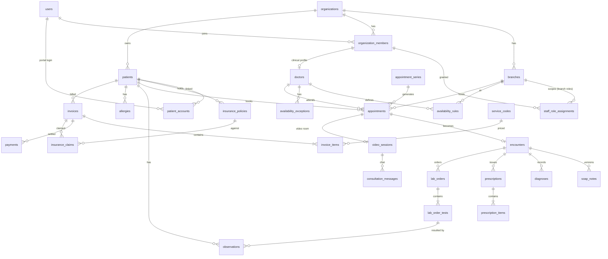

# Database Design — Clinik OS

PostgreSQL 16. Status: **approved design, v1.2** (decisions D1–D3, D5, D6 and the v1.2 simplifications D11r and D18–D23, see ARCHITECTURE §11). Nothing has been implemented yet. v1.2 removes GST, gapless numbering, the duplicate-candidate table, the import-job table and five triggers. It keeps tenant isolation, row-level security, composite FKs, the double-booking constraint and the clinical integrity rules.
This doc is the source of truth for table structure, constraints, triggers and database roles. All DDL below was loaded into a scratch PostgreSQL 16 database and smoke-tested (see §13).

---

## 1. Design principles

| # | Principle | How it is enforced |
|---|---|---|
| P1 | Every tenant-owned row carries `organization_id` | `NOT NULL` column on every tenant table |
| P2 | A row can never reference a row in another organization | **Composite foreign keys** `(organization_id, x_id) → parent(organization_id, id)`. Every tenant parent table has `UNIQUE (organization_id, id)` |
| P3 | Defense in depth for tenant isolation | Row-Level Security on every tenant table (§11). The application filter is still the primary control |
| P4 | Invariants live in the database when they are cheap to express | `CHECK`, partial unique indexes, `EXCLUDE` constraints (double booking) |
| P5 | Clinical and financial history is never silently changed | Signed notes, prescriptions and issued invoices are frozen. Clinical and payment rows cannot be deleted. Six trigger rules R1–R6 (§10). Corrections are made as new versions or with an `entered_in_error` status |
| P6 | Money is stored as integers | `bigint` in minor units (paise). One currency (INR) for all organizations in MVP. **No tax** (D11r) |
| P7 | All times are absolute | `timestamptz` for instants. Branch `timezone` (IANA name) is used to interpret local schedules |
| P8 | Enumerations are `text + CHECK`, not PG `ENUM` | Easier to change in migrations |
| P9 | Imported data is traceable and re-importable | `source_system` + `source_ref` with a partial unique index make the import idempotent |
| P10 | Audit logs are append-only and have no FKs | Grants revoked plus a trigger. Logs outlive the rows they describe |

**Primary keys:** `uuid DEFAULT gen_random_uuid()`. *Assumption:* the app may generate UUIDv7 for index locality. This doesn't change the schema.
**Common columns:** `created_at timestamptz NOT NULL DEFAULT now()` and `updated_at` (maintained by the `set_updated_at` trigger). They are omitted from the column tables below for brevity but are present in the DDL.

---

## 2. Entity-relationship overview



---

## 3. Extensions, roles, helpers

```sql
CREATE EXTENSION IF NOT EXISTS pgcrypto;   -- gen_random_uuid(), digest()
CREATE EXTENSION IF NOT EXISTS citext;     -- case-insensitive email
CREATE EXTENSION IF NOT EXISTS btree_gist; -- uuid equality inside EXCLUDE/GiST
CREATE EXTENSION IF NOT EXISTS pg_trgm;    -- fuzzy patient name search

-- Updated-at maintenance
CREATE OR REPLACE FUNCTION set_updated_at() RETURNS trigger LANGUAGE plpgsql AS $$
BEGIN NEW.updated_at := now(); RETURN NEW; END $$;

-- Generic "this row is frozen" guard; TG_ARGV[0] is a SQL boolean expression on OLD
CREATE OR REPLACE FUNCTION forbid_change_when_frozen() RETURNS trigger LANGUAGE plpgsql AS $$
DECLARE frozen boolean;
BEGIN
  EXECUTE format('SELECT %s FROM (SELECT ($1).*) AS old', TG_ARGV[0]) INTO frozen USING OLD;
  IF frozen THEN
    RAISE EXCEPTION '% row % is immutable', TG_TABLE_NAME, OLD.id USING ERRCODE = 'check_violation';
  END IF;
  RETURN CASE WHEN TG_OP = 'DELETE' THEN OLD ELSE NEW END;
END $$;

-- Append-only tables (audit_logs, consultation_messages)
CREATE OR REPLACE FUNCTION forbid_mutation() RETURNS trigger LANGUAGE plpgsql AS $$
BEGIN
  RAISE EXCEPTION '% is append-only', TG_TABLE_NAME USING ERRCODE = 'check_violation';
END $$;

-- Clinical / financial rows are never hard-deleted (use status 'entered_in_error', 'void', etc.)
CREATE OR REPLACE FUNCTION forbid_delete() RETURNS trigger LANGUAGE plpgsql AS $$
BEGIN
  RAISE EXCEPTION 'rows in % cannot be deleted', TG_TABLE_NAME USING ERRCODE = 'check_violation';
END $$;
```

All table-specific trigger functions are in §10, after the tables they reference.

Database roles (created by infrastructure, not migrations):

| Role | Used by | Rights |
|---|---|---|
| `clinic_migrator` | migrations only | Owns all tables. Never used at runtime |
| `clinic_app` | API process | DML on tables. **Not owner, no `BYPASSRLS`**. Subject to RLS |
| `clinic_worker` | background worker (**reminders only**, D22) | Explicit grants only (§11.3). Subject to RLS. One cross-tenant discovery policy (due notifications) and column-limited UPDATE grants. All other work runs inside a tenant context |

---

## 4. Identity and tenancy

### 4.1 Tables

**users**: one login identity per email, shared by staff and patients.

| Column | Type | Notes |
|---|---|---|
| id | uuid PK | |
| email | citext | `UNIQUE NOT NULL` |
| password_hash | text | argon2id. NULL until an invitation is accepted |
| full_name | text | 1–200 chars |
| phone | text | |
| is_platform_admin | boolean | default false. Platform role is a flag, not a membership |
| status | text | `pending, active, disabled` |
| email_verified_at, last_login_at, locked_until | timestamptz | |
| failed_login_count | int | default 0 |

**sessions**: server-side sessions. The cookie holds an opaque token, and the DB stores only its SHA-256.
**auth_tokens**: email-verification and password-reset tokens (hashed, single-use, short expiry).
**organizations**: tenants. **branches**: physical clinic locations of an organization.
**organization_members**: user ↔ organization (staff only; patients link via `patient_accounts`).
**staff_role_assignments**: the RBAC grant table. Org roles have `branch_id NULL`. Branch roles must name a branch.
**invitations**: staff and patient-portal invitations (defined in §5 because it references `patients`).

```sql
CREATE TABLE users (
  id                 uuid PRIMARY KEY DEFAULT gen_random_uuid(),
  email              citext NOT NULL UNIQUE,
  password_hash      text,
  full_name          text NOT NULL CHECK (length(full_name) BETWEEN 1 AND 200),
  phone              text,
  is_platform_admin  boolean NOT NULL DEFAULT false,
  status             text NOT NULL DEFAULT 'pending' CHECK (status IN ('pending','active','disabled')),
  email_verified_at  timestamptz,
  failed_login_count integer NOT NULL DEFAULT 0 CHECK (failed_login_count >= 0),
  locked_until       timestamptz,
  last_login_at      timestamptz,
  created_at         timestamptz NOT NULL DEFAULT now(),
  updated_at         timestamptz NOT NULL DEFAULT now(),
  CHECK (status <> 'active' OR password_hash IS NOT NULL)
);

CREATE TABLE sessions (
  id                  uuid PRIMARY KEY DEFAULT gen_random_uuid(),
  user_id             uuid NOT NULL REFERENCES users(id) ON DELETE CASCADE,
  token_hash          bytea NOT NULL UNIQUE,
  ip                  inet,
  user_agent          text,
  created_at          timestamptz NOT NULL DEFAULT now(),
  last_seen_at        timestamptz NOT NULL DEFAULT now(),
  idle_expires_at     timestamptz NOT NULL,
  absolute_expires_at timestamptz NOT NULL,
  revoked_at          timestamptz,
  CHECK (absolute_expires_at > created_at)
);
CREATE INDEX sessions_user_active_idx ON sessions (user_id) WHERE revoked_at IS NULL;

CREATE TABLE auth_tokens (
  id          uuid PRIMARY KEY DEFAULT gen_random_uuid(),
  user_id     uuid NOT NULL REFERENCES users(id) ON DELETE CASCADE,
  purpose     text NOT NULL CHECK (purpose IN ('email_verify','password_reset')),
  token_hash  bytea NOT NULL UNIQUE,
  expires_at  timestamptz NOT NULL,
  consumed_at timestamptz,
  created_at  timestamptz NOT NULL DEFAULT now()
);
CREATE INDEX auth_tokens_user_idx ON auth_tokens (user_id, purpose);

CREATE TABLE organizations (
  id               uuid PRIMARY KEY DEFAULT gen_random_uuid(),
  name             text NOT NULL CHECK (length(name) BETWEEN 1 AND 200),
  slug             text NOT NULL UNIQUE CHECK (slug ~ '^[a-z0-9][a-z0-9-]{2,62}$'),
  status           text NOT NULL DEFAULT 'active' CHECK (status IN ('active','suspended')),
  default_timezone text NOT NULL DEFAULT 'UTC',
  currency         char(3) NOT NULL DEFAULT 'INR' CHECK (currency = 'INR'),   -- MVP: INR only (D11)
  created_at       timestamptz NOT NULL DEFAULT now(),
  updated_at       timestamptz NOT NULL DEFAULT now()
);

CREATE TABLE branches (
  id              uuid PRIMARY KEY DEFAULT gen_random_uuid(),
  organization_id uuid NOT NULL REFERENCES organizations(id),
  name            text NOT NULL CHECK (length(name) BETWEEN 1 AND 200),
  code            text NOT NULL CHECK (code ~ '^[A-Z0-9-]{2,16}$'),
  timezone        text NOT NULL,              -- IANA, validated in app
  phone           text,
  email           citext,
  address_line1   text, address_line2 text, city text, region text, postal_code text,
  country         char(2),
  status          text NOT NULL DEFAULT 'active' CHECK (status IN ('active','inactive')),
  created_at      timestamptz NOT NULL DEFAULT now(),
  updated_at      timestamptz NOT NULL DEFAULT now(),
  UNIQUE (organization_id, id),
  UNIQUE (organization_id, code)
);

CREATE TABLE organization_members (
  organization_id uuid NOT NULL REFERENCES organizations(id),
  user_id         uuid NOT NULL REFERENCES users(id),
  status          text NOT NULL DEFAULT 'active' CHECK (status IN ('active','suspended')),
  joined_at       timestamptz NOT NULL DEFAULT now(),
  PRIMARY KEY (organization_id, user_id)
);
CREATE INDEX organization_members_user_idx ON organization_members (user_id);

CREATE TABLE staff_role_assignments (
  id              uuid PRIMARY KEY DEFAULT gen_random_uuid(),
  organization_id uuid NOT NULL,
  user_id         uuid NOT NULL,
  role            text NOT NULL CHECK (role IN ('org_owner','org_admin','branch_manager','doctor','receptionist')),
  branch_id       uuid,
  created_by      uuid REFERENCES users(id),
  created_at      timestamptz NOT NULL DEFAULT now(),
  FOREIGN KEY (organization_id, user_id) REFERENCES organization_members (organization_id, user_id) ON DELETE CASCADE,
  FOREIGN KEY (organization_id, branch_id) REFERENCES branches (organization_id, id),
  CHECK ((role IN ('org_owner','org_admin')) = (branch_id IS NULL)),
  UNIQUE NULLS NOT DISTINCT (organization_id, user_id, role, branch_id)
);
CREATE UNIQUE INDEX staff_roles_one_owner_uq ON staff_role_assignments (organization_id) WHERE role = 'org_owner';
CREATE INDEX staff_roles_branch_idx ON staff_role_assignments (organization_id, branch_id, role);
CREATE INDEX staff_roles_user_idx   ON staff_role_assignments (user_id);
```

### 4.2 Key relationships and rules

- A user may belong to several organizations, with several roles in each. For example, an owner who is also a doctor at Branch A has rows `org_owner/NULL` and `doctor/BranchA`.
- **At most one** `org_owner` per org (DB). **At least one** is app-enforced: ownership is moved through a transfer operation, so an org is never left without an owner.
- Removing a member cascades only their role rows. Clinical rows reference `doctors`, which is never hard-deleted (`is_active=false`).

---

## 5. Doctors, patients, invitations, insurance

**doctors**: clinical profile of a member. Where a doctor practices is defined by `staff_role_assignments(role='doctor', branch_id)`. There is no separate doctor_branches table, so there is only one source of truth.
**patients**: one record **per organization**, shared across that organization's branches (**decision D1**). Every record carries a `verification_status` (**decisions D6/D19**). Staff-created records are `verified` at creation. Portal self-registrations start `pending`. **Nothing is merged automatically.**
**patient_accounts**: links a portal `user` to a patient record. One user can hold patient records in several organizations.

```sql
-- Human-readable numbers come from plain sequences (D20). Gaps are allowed; uniqueness is per org.
CREATE SEQUENCE mrn_seq;
CREATE SEQUENCE invoice_number_seq;
CREATE SEQUENCE claim_number_seq;

CREATE TABLE doctors (
  id                   uuid PRIMARY KEY DEFAULT gen_random_uuid(),
  organization_id      uuid NOT NULL,
  user_id              uuid NOT NULL,
  display_name         text NOT NULL CHECK (length(display_name) BETWEEN 1 AND 200),
  specialty            text,
  registration_number  text,
  default_slot_minutes smallint NOT NULL DEFAULT 15 CHECK (default_slot_minutes BETWEEN 5 AND 240),
  bio                  text CHECK (length(bio) <= 2000),
  is_active            boolean NOT NULL DEFAULT true,
  created_at           timestamptz NOT NULL DEFAULT now(),
  updated_at           timestamptz NOT NULL DEFAULT now(),
  FOREIGN KEY (organization_id, user_id) REFERENCES organization_members (organization_id, user_id),
  UNIQUE (organization_id, user_id),
  UNIQUE (organization_id, id)
);

CREATE TABLE patients (
  id                  uuid PRIMARY KEY DEFAULT gen_random_uuid(),
  organization_id     uuid NOT NULL REFERENCES organizations(id),
  mrn                 text NOT NULL,
  first_name          text NOT NULL CHECK (length(first_name) BETWEEN 1 AND 100),
  last_name           text NOT NULL CHECK (length(last_name) BETWEEN 1 AND 100),
  date_of_birth       date NOT NULL,
  sex_at_birth        text CHECK (sex_at_birth IN ('female','male','intersex','unknown')),
  gender              text,
  email               citext,
  phone               text,
  address_line1 text, address_line2 text, city text, region text, postal_code text,
  country             char(2),
  preferred_branch_id uuid,
  status              text NOT NULL DEFAULT 'active' CHECK (status IN ('active','inactive','deceased')),
  deceased_at         timestamptz,
  verification_status text NOT NULL DEFAULT 'pending' CHECK (verification_status IN ('pending','verified')),
  verified_at         timestamptz,
  verified_by         uuid REFERENCES users(id),
  source_system       text NOT NULL DEFAULT 'manual' CHECK (source_system IN ('manual','portal','synthea')),
  source_ref          text,
  created_by          uuid REFERENCES users(id),
  created_at          timestamptz NOT NULL DEFAULT now(),
  updated_at          timestamptz NOT NULL DEFAULT now(),
  UNIQUE (organization_id, id),
  UNIQUE (organization_id, mrn),
  FOREIGN KEY (organization_id, preferred_branch_id) REFERENCES branches (organization_id, id),
  CHECK ((status = 'deceased') = (deceased_at IS NOT NULL)),
  CHECK ((verification_status = 'verified') = (verified_at IS NOT NULL))
);
CREATE UNIQUE INDEX patients_source_uq ON patients (organization_id, source_system, source_ref) WHERE source_ref IS NOT NULL;
CREATE INDEX patients_dob_idx  ON patients (organization_id, date_of_birth);
CREATE INDEX patients_name_idx ON patients (organization_id, lower(last_name), lower(first_name));
CREATE INDEX patients_name_trgm ON patients USING gin ((lower(last_name || ' ' || first_name)) gin_trgm_ops);
CREATE INDEX patients_email_idx ON patients (organization_id, email) WHERE email IS NOT NULL;
CREATE INDEX patients_phone_idx ON patients (organization_id, phone) WHERE phone IS NOT NULL;   -- stored as E.164
CREATE INDEX patients_pending_idx ON patients (organization_id, created_at) WHERE verification_status = 'pending';


CREATE TABLE patient_accounts (
  organization_id uuid NOT NULL,
  patient_id      uuid NOT NULL,
  user_id         uuid NOT NULL REFERENCES users(id),
  relationship    text NOT NULL DEFAULT 'self' CHECK (relationship IN ('self')),  -- guardians deferred (A7)
  linked_at       timestamptz NOT NULL DEFAULT now(),
  PRIMARY KEY (organization_id, patient_id, user_id),
  FOREIGN KEY (organization_id, patient_id) REFERENCES patients (organization_id, id)
);
CREATE UNIQUE INDEX patient_accounts_self_patient_uq ON patient_accounts (organization_id, patient_id) WHERE relationship = 'self';
CREATE UNIQUE INDEX patient_accounts_self_user_uq    ON patient_accounts (organization_id, user_id)    WHERE relationship = 'self';
CREATE INDEX patient_accounts_user_idx ON patient_accounts (user_id);

CREATE TABLE invitations (
  id              uuid PRIMARY KEY DEFAULT gen_random_uuid(),
  organization_id uuid NOT NULL REFERENCES organizations(id),
  email           citext NOT NULL,
  role            text NOT NULL CHECK (role IN ('org_owner','org_admin','branch_manager','doctor','receptionist','patient')),
  branch_id       uuid,
  patient_id      uuid,
  token_hash      bytea NOT NULL UNIQUE,
  invited_by      uuid NOT NULL REFERENCES users(id),
  expires_at      timestamptz NOT NULL,
  accepted_at     timestamptz,
  revoked_at      timestamptz,
  created_at      timestamptz NOT NULL DEFAULT now(),
  FOREIGN KEY (organization_id, branch_id)  REFERENCES branches (organization_id, id),
  FOREIGN KEY (organization_id, patient_id) REFERENCES patients (organization_id, id),
  CHECK (
       (role IN ('org_owner','org_admin')                     AND branch_id IS NULL     AND patient_id IS NULL)
    OR (role IN ('branch_manager','doctor','receptionist')    AND branch_id IS NOT NULL AND patient_id IS NULL)
    OR (role = 'patient'                                      AND branch_id IS NULL     AND patient_id IS NOT NULL)
  ),
  CHECK (accepted_at IS NULL OR revoked_at IS NULL)
);
CREATE UNIQUE INDEX invitations_pending_uq ON invitations (organization_id, email, role, branch_id, patient_id)
  NULLS NOT DISTINCT WHERE accepted_at IS NULL AND revoked_at IS NULL;

CREATE TABLE insurance_policies (
  id              uuid PRIMARY KEY DEFAULT gen_random_uuid(),
  organization_id uuid NOT NULL,
  patient_id      uuid NOT NULL,
  payer_name      text NOT NULL,
  plan_name       text,
  member_id       text NOT NULL,
  group_number    text,
  valid_from      date,
  valid_to        date,
  is_primary      boolean NOT NULL DEFAULT false,
  status          text NOT NULL DEFAULT 'active' CHECK (status IN ('active','inactive')),
  created_at      timestamptz NOT NULL DEFAULT now(),
  updated_at      timestamptz NOT NULL DEFAULT now(),
  FOREIGN KEY (organization_id, patient_id) REFERENCES patients (organization_id, id),
  UNIQUE (organization_id, id),
  UNIQUE (organization_id, id, patient_id),     -- target for same-patient FK from claims
  CHECK (valid_to IS NULL OR valid_from IS NULL OR valid_to >= valid_from)
);
CREATE UNIQUE INDEX insurance_one_primary_uq ON insurance_policies (organization_id, patient_id) WHERE is_primary AND status = 'active';
```

Notes
- **Duplicate warning (D6/D19)** is a query, not a table. On every staff or portal create, the `patients` service looks in the same organization for the same DOB plus a name trigram similarity ≥ 0.6, or the same DOB plus the same email or phone. Synthea seeding skips it.
- **Staff path:** if matches exist, `POST /patients` returns `409 POSSIBLE_DUPLICATE` with them. Staff either open the existing record or resubmit with `acknowledgeDuplicates=true`. The new record is then created `verified`, and the acknowledgement is audited.
- **Portal path:** the record is created `pending`. The response is identical whether or not a match exists. The patient may log in and book. Opening an encounter or issuing an invoice requires `verified`, enforced in the DB by rule **R5** (§10), so verification happens at the front desk, normally at check-in.
- **Staff resolution** (from the verification queue, which re-runs the same match query):
  - *Verify:* `verification_status='verified'`.
  - *Mark as duplicate:* `status='inactive'` and the reason is audited. Staff link the patient's portal login to the existing record through a normal patient invitation, and rebook any future appointments by hand. No automatic relinking and no merging (D19).
- MRN = `'MRN-' || lpad(nextval('mrn_seq')::text, 6, '0')`. Unique per org (`UNIQUE (organization_id, mrn)`), gaps allowed (D20).
- `date_of_birth <= today` is validated in the app. A CHECK with `current_date` is not re-evaluated, so it would give false confidence.
- The trigram index is not tenant-prefixed. RLS and the `organization_id` predicate filter its results. That is acceptable at internship scale.

---

## 6. Scheduling

**availability_rules**: weekly recurring working hours per doctor per branch, in branch-local time.
**availability_exceptions**: absolute-time blocks (`unavailable`: leave or a meeting) or additions (`extra`).
**appointment_series**: parent of recurring bookings. Instances are **materialized** as rows in `appointments`.
**appointments**: the bookable unit. **Double booking is prevented by `EXCLUDE` constraints**, not by application checks alone.

Free slots are **computed, never stored**: rules − exceptions(unavailable) + exceptions(extra) − active appointments.

```sql
CREATE TABLE availability_rules (
  id              uuid PRIMARY KEY DEFAULT gen_random_uuid(),
  organization_id uuid NOT NULL,
  doctor_id       uuid NOT NULL,
  branch_id       uuid NOT NULL,
  iso_weekday     smallint NOT NULL CHECK (iso_weekday BETWEEN 1 AND 7),   -- 1 = Monday
  start_minute    smallint NOT NULL CHECK (start_minute BETWEEN 0 AND 1439), -- minutes after local midnight
  end_minute      smallint NOT NULL CHECK (end_minute BETWEEN 1 AND 1440),
  slot_minutes    smallint NOT NULL CHECK (slot_minutes BETWEEN 5 AND 240),
  visit_mode      text NOT NULL DEFAULT 'both' CHECK (visit_mode IN ('in_person','video','both')),
  effective_from  date NOT NULL,
  effective_to    date,
  created_at      timestamptz NOT NULL DEFAULT now(),
  updated_at      timestamptz NOT NULL DEFAULT now(),
  FOREIGN KEY (organization_id, doctor_id) REFERENCES doctors (organization_id, id),
  FOREIGN KEY (organization_id, branch_id) REFERENCES branches (organization_id, id),
  UNIQUE (organization_id, id),
  CHECK (end_minute > start_minute),
  CHECK (effective_to IS NULL OR effective_to >= effective_from),
  -- a doctor cannot have overlapping working hours, even across branches
  CONSTRAINT availability_rules_no_overlap EXCLUDE USING gist (
    doctor_id   WITH =,
    iso_weekday WITH =,
    int4range(start_minute, end_minute)            WITH &&,
    daterange(effective_from, effective_to, '[]')  WITH &&
  )
);

CREATE TABLE availability_exceptions (
  id              uuid PRIMARY KEY DEFAULT gen_random_uuid(),
  organization_id uuid NOT NULL,
  doctor_id       uuid NOT NULL,
  branch_id       uuid,
  kind            text NOT NULL CHECK (kind IN ('unavailable','extra')),
  starts_at       timestamptz NOT NULL,
  ends_at         timestamptz NOT NULL,
  reason          text CHECK (length(reason) <= 500),
  created_by      uuid NOT NULL REFERENCES users(id),
  created_at      timestamptz NOT NULL DEFAULT now(),
  FOREIGN KEY (organization_id, doctor_id) REFERENCES doctors (organization_id, id),
  FOREIGN KEY (organization_id, branch_id) REFERENCES branches (organization_id, id),
  CHECK (ends_at > starts_at),
  CHECK (kind = 'unavailable' OR branch_id IS NOT NULL)
);
CREATE INDEX availability_exceptions_range_idx ON availability_exceptions USING gist (doctor_id, tstzrange(starts_at, ends_at));

CREATE TABLE appointment_series (
  id               uuid PRIMARY KEY DEFAULT gen_random_uuid(),
  organization_id  uuid NOT NULL,
  branch_id        uuid NOT NULL,
  doctor_id        uuid NOT NULL,
  patient_id       uuid NOT NULL,
  frequency        text NOT NULL CHECK (frequency IN ('weekly','biweekly')),
  occurrences      smallint NOT NULL CHECK (occurrences BETWEEN 2 AND 12),
  first_starts_at  timestamptz NOT NULL,
  duration_minutes smallint NOT NULL CHECK (duration_minutes BETWEEN 5 AND 240),
  visit_mode       text NOT NULL CHECK (visit_mode IN ('in_person','video')),
  status           text NOT NULL DEFAULT 'active' CHECK (status IN ('active','cancelled')),
  created_by       uuid NOT NULL REFERENCES users(id),
  created_at       timestamptz NOT NULL DEFAULT now(),
  FOREIGN KEY (organization_id, branch_id)  REFERENCES branches (organization_id, id),
  FOREIGN KEY (organization_id, doctor_id)  REFERENCES doctors  (organization_id, id),
  FOREIGN KEY (organization_id, patient_id) REFERENCES patients (organization_id, id),
  UNIQUE (organization_id, id)
);

CREATE TABLE appointments (
  id                  uuid PRIMARY KEY DEFAULT gen_random_uuid(),
  organization_id     uuid NOT NULL,
  branch_id           uuid NOT NULL,
  doctor_id           uuid NOT NULL,
  patient_id          uuid NOT NULL,
  series_id           uuid,
  service_code_id     uuid,                  -- FK added in §8
  visit_mode          text NOT NULL CHECK (visit_mode IN ('in_person','video')),
  status              text NOT NULL DEFAULT 'scheduled'
                      CHECK (status IN ('scheduled','confirmed','checked_in','in_progress','completed','cancelled','no_show')),
  starts_at           timestamptz NOT NULL,
  ends_at             timestamptz NOT NULL,
  reason              text CHECK (length(reason) <= 500),
  booking_channel     text NOT NULL CHECK (booking_channel IN ('staff','portal')),
  booked_by           uuid NOT NULL REFERENCES users(id),
  cancelled_at        timestamptz,
  cancelled_by        uuid REFERENCES users(id),
  cancellation_reason text CHECK (length(cancellation_reason) <= 500),
  version             integer NOT NULL DEFAULT 1,    -- optimistic locking for reschedule
  created_at          timestamptz NOT NULL DEFAULT now(),
  updated_at          timestamptz NOT NULL DEFAULT now(),
  FOREIGN KEY (organization_id, branch_id)  REFERENCES branches (organization_id, id),
  FOREIGN KEY (organization_id, doctor_id)  REFERENCES doctors  (organization_id, id),
  FOREIGN KEY (organization_id, patient_id) REFERENCES patients (organization_id, id),
  FOREIGN KEY (organization_id, series_id)  REFERENCES appointment_series (organization_id, id),
  UNIQUE (organization_id, id),
  UNIQUE (organization_id, id, patient_id),     -- target for same-patient FKs (encounters, invoices)
  CHECK (ends_at > starts_at),
  CHECK (ends_at - starts_at <= interval '8 hours'),
  CHECK ((status = 'cancelled') = (cancelled_at IS NOT NULL)),
  CONSTRAINT appointments_no_doctor_overlap EXCLUDE USING gist (
    doctor_id WITH =, tstzrange(starts_at, ends_at, '[)') WITH &&
  ) WHERE (status NOT IN ('cancelled','no_show')),
  CONSTRAINT appointments_no_patient_overlap EXCLUDE USING gist (
    patient_id WITH =, tstzrange(starts_at, ends_at, '[)') WITH &&
  ) WHERE (status NOT IN ('cancelled','no_show'))
);
CREATE INDEX appointments_branch_time_idx  ON appointments (organization_id, branch_id, starts_at);
CREATE INDEX appointments_doctor_time_idx  ON appointments (organization_id, doctor_id, starts_at);
CREATE INDEX appointments_patient_time_idx ON appointments (organization_id, patient_id, starts_at DESC);
CREATE INDEX appointments_series_idx       ON appointments (series_id) WHERE series_id IS NOT NULL;

CREATE TABLE notifications (                     -- outbox + delivery record
  id                uuid PRIMARY KEY DEFAULT gen_random_uuid(),
  organization_id   uuid NOT NULL REFERENCES organizations(id),
  recipient_user_id uuid REFERENCES users(id),
  recipient_email   citext NOT NULL,
  channel           text NOT NULL DEFAULT 'email' CHECK (channel IN ('email')),
  template          text NOT NULL,                -- e.g. 'appointment.reminder_24h'
  payload           jsonb NOT NULL DEFAULT '{}',  -- ids + display data, minimal PHI
  related_type      text,
  related_id        uuid,
  dedupe_key        text NOT NULL,                -- e.g. 'reminder24h:<appointment_id>:<version>'
  scheduled_for     timestamptz NOT NULL,
  status            text NOT NULL DEFAULT 'pending' CHECK (status IN ('pending','sending','sent','failed','cancelled')),
  attempts          smallint NOT NULL DEFAULT 0 CHECK (attempts BETWEEN 0 AND 10),
  last_error        text,
  sent_at           timestamptz,
  created_at        timestamptz NOT NULL DEFAULT now(),
  UNIQUE (organization_id, dedupe_key)
);
CREATE INDEX notifications_due_idx ON notifications (scheduled_for) WHERE status = 'pending';
CREATE INDEX notifications_related_idx ON notifications (organization_id, related_type, related_id);
```

Rules that cannot be expressed as constraints (enforced in the service layer with a test for each):
1. An appointment must fall inside an availability rule or `extra` exception and must not intersect an `unavailable` exception. *Staff may override, and an override is audited.*
2. `availability_rules`, `availability_exceptions`, `appointment_series` and `appointments` must use a branch where the doctor holds a `doctor` role. Removing a doctor's branch role is refused while they still have future appointments or open rules there. Both are service checks with tests (moved out of triggers in v1.2, D21).
3. Recurring series are created **all-or-nothing** in one transaction. If any occurrence violates the exclusion constraint, the whole series is rejected and the conflicting dates are returned (*Assumption A6*).
4. On reschedule (`starts_at` change), `version` is incremented. This invalidates queued reminders through `dedupe_key`.
5. **Known limitation:** `doctor_id` is per-organization, so the same human working in two organizations can be double-booked across them. Accepted for MVP.

---

## 7. Electronic medical records

"Medical records" is the aggregate of these tables. The **encounter** is the hub: one visit, in person, by video, or imported.

| Table | Purpose |
|---|---|
| encounters | One clinical visit. Created from an appointment (1:1) or by import |
| soap_notes | Versioned SOAP documentation. Signed versions are immutable. An amendment is a new version |
| diagnoses | Conditions / problem list (ICD-10 or SNOMED) |
| allergies | Allergy & intolerance list |
| prescriptions + prescription_items | Doctor-signed medication orders. Drafts are allowed (video drafting) |
| lab_orders + lab_order_tests | Ordered tests |
| observations | Lab results **and** vitals (FHIR-aligned). Lab results are `category='laboratory'` |
| files | Uploaded lab reports and attachments (object storage metadata) |

```sql
CREATE TABLE encounters (
  id                     uuid PRIMARY KEY DEFAULT gen_random_uuid(),
  organization_id        uuid NOT NULL,
  branch_id              uuid,
  patient_id             uuid NOT NULL,
  doctor_id              uuid,
  appointment_id         uuid,
  encounter_type         text NOT NULL CHECK (encounter_type IN ('in_person','video','imported')),
  status                 text NOT NULL DEFAULT 'open' CHECK (status IN ('open','closed','entered_in_error')),
  started_at             timestamptz NOT NULL,
  ended_at               timestamptz,
  reason_text            text CHECK (length(reason_text) <= 1000),
  external_provider_name text,                   -- imported: Practitioner display only
  external_facility_name text,
  patient_summary        text CHECK (length(patient_summary) <= 4000),  -- doctor-written, patient-facing (D5)
  patient_summary_released_at timestamptz,
  source_system          text NOT NULL DEFAULT 'native' CHECK (source_system IN ('native','synthea')),
  source_ref             text,
  closed_at              timestamptz,
  created_at             timestamptz NOT NULL DEFAULT now(),
  updated_at             timestamptz NOT NULL DEFAULT now(),
  FOREIGN KEY (organization_id, branch_id)  REFERENCES branches (organization_id, id),
  FOREIGN KEY (organization_id, patient_id) REFERENCES patients (organization_id, id),
  FOREIGN KEY (organization_id, doctor_id)  REFERENCES doctors  (organization_id, id),
  FOREIGN KEY (organization_id, appointment_id, patient_id) REFERENCES appointments (organization_id, id, patient_id),
  UNIQUE (organization_id, id),
  UNIQUE (organization_id, id, doctor_id),       -- target: author must be the encounter's doctor
  UNIQUE (organization_id, appointment_id),
  CHECK (encounter_type = 'imported' OR (doctor_id IS NOT NULL AND branch_id IS NOT NULL)),
  CHECK ((encounter_type = 'imported') = (source_system = 'synthea')),
  CHECK (ended_at IS NULL OR ended_at >= started_at),
  CHECK (patient_summary_released_at IS NULL OR patient_summary IS NOT NULL)
);
CREATE UNIQUE INDEX encounters_source_uq ON encounters (organization_id, source_system, source_ref) WHERE source_ref IS NOT NULL;
CREATE INDEX encounters_patient_idx ON encounters (organization_id, patient_id, started_at DESC);
CREATE INDEX encounters_doctor_idx  ON encounters (organization_id, doctor_id, started_at DESC);

CREATE TABLE soap_notes (
  id               uuid PRIMARY KEY DEFAULT gen_random_uuid(),
  organization_id  uuid NOT NULL,
  encounter_id     uuid NOT NULL,
  author_doctor_id uuid NOT NULL,
  version          integer NOT NULL CHECK (version >= 1),
  status           text NOT NULL DEFAULT 'draft' CHECK (status IN ('draft','signed')),
  subjective       text CHECK (length(subjective) <= 20000),
  objective        text CHECK (length(objective)  <= 20000),
  assessment       text CHECK (length(assessment) <= 20000),
  plan             text CHECK (length(plan)       <= 20000),
  amendment_reason text CHECK (length(amendment_reason) <= 1000),
  signed_at        timestamptz,
  created_at       timestamptz NOT NULL DEFAULT now(),
  updated_at       timestamptz NOT NULL DEFAULT now(),
  FOREIGN KEY (organization_id, encounter_id, author_doctor_id) REFERENCES encounters (organization_id, id, doctor_id),
  UNIQUE (organization_id, id),
  UNIQUE (encounter_id, version),
  CHECK ((status = 'signed') = (signed_at IS NOT NULL)),
  CHECK (version = 1 OR amendment_reason IS NOT NULL)
);
CREATE UNIQUE INDEX soap_notes_one_draft_uq ON soap_notes (encounter_id) WHERE status = 'draft';
CREATE TRIGGER soap_notes_immutable BEFORE UPDATE OR DELETE ON soap_notes
  FOR EACH ROW EXECUTE FUNCTION forbid_change_when_frozen('old.status = ''signed''');

CREATE TABLE diagnoses (
  id                    uuid PRIMARY KEY DEFAULT gen_random_uuid(),
  organization_id       uuid NOT NULL,
  patient_id            uuid NOT NULL,
  encounter_id          uuid,
  code_system           text NOT NULL CHECK (code_system IN ('icd10','snomed')),
  code                  text NOT NULL CHECK (length(code) <= 32),
  display               text NOT NULL CHECK (length(display) <= 500),
  clinical_status       text NOT NULL DEFAULT 'active' CHECK (clinical_status IN ('active','recurrence','remission','resolved','inactive')),
  verification_status   text NOT NULL DEFAULT 'confirmed' CHECK (verification_status IN ('provisional','confirmed','refuted','entered_in_error')),
  onset_date            date,
  abatement_date        date,
  recorded_by_doctor_id uuid,
  source_system         text NOT NULL DEFAULT 'native' CHECK (source_system IN ('native','synthea')),
  source_ref            text,
  created_at            timestamptz NOT NULL DEFAULT now(),
  updated_at            timestamptz NOT NULL DEFAULT now(),
  FOREIGN KEY (organization_id, patient_id)   REFERENCES patients   (organization_id, id),
  FOREIGN KEY (organization_id, encounter_id) REFERENCES encounters (organization_id, id),
  FOREIGN KEY (organization_id, recorded_by_doctor_id) REFERENCES doctors (organization_id, id),
  UNIQUE (organization_id, id),
  CHECK (source_system <> 'native' OR recorded_by_doctor_id IS NOT NULL),
  CHECK (abatement_date IS NULL OR onset_date IS NULL OR abatement_date >= onset_date)
);
CREATE UNIQUE INDEX diagnoses_source_uq ON diagnoses (organization_id, source_system, source_ref) WHERE source_ref IS NOT NULL;
CREATE INDEX diagnoses_patient_idx ON diagnoses (organization_id, patient_id, clinical_status);

CREATE TABLE allergies (
  id                    uuid PRIMARY KEY DEFAULT gen_random_uuid(),
  organization_id       uuid NOT NULL,
  patient_id            uuid NOT NULL,
  substance_code_system text CHECK (substance_code_system IN ('snomed','rxnorm','other')),
  substance_code        text,
  substance_display     text NOT NULL CHECK (length(substance_display) <= 300),
  category              text CHECK (category IN ('food','medication','environment','biologic')),
  criticality           text CHECK (criticality IN ('low','high','unable_to_assess')),
  reaction              text CHECK (length(reaction) <= 1000),
  status                text NOT NULL DEFAULT 'active' CHECK (status IN ('active','inactive','resolved','entered_in_error')),
  recorded_by_doctor_id uuid,
  source_system         text NOT NULL DEFAULT 'native' CHECK (source_system IN ('native','synthea')),
  source_ref            text,
  created_at            timestamptz NOT NULL DEFAULT now(),
  updated_at            timestamptz NOT NULL DEFAULT now(),
  FOREIGN KEY (organization_id, patient_id) REFERENCES patients (organization_id, id),
  FOREIGN KEY (organization_id, recorded_by_doctor_id) REFERENCES doctors (organization_id, id),
  UNIQUE (organization_id, id)
);
CREATE UNIQUE INDEX allergies_source_uq ON allergies (organization_id, source_system, source_ref) WHERE source_ref IS NOT NULL;
CREATE INDEX allergies_patient_idx ON allergies (organization_id, patient_id) WHERE status = 'active';

CREATE TABLE prescriptions (
  id                       uuid PRIMARY KEY DEFAULT gen_random_uuid(),
  organization_id          uuid NOT NULL,
  patient_id               uuid NOT NULL,
  encounter_id             uuid,
  prescriber_doctor_id     uuid,
  status                   text NOT NULL DEFAULT 'draft' CHECK (status IN ('draft','active','completed','cancelled','entered_in_error')),
  signed_at                timestamptz,
  notes                    text CHECK (length(notes) <= 2000),
  external_prescriber_name text,
  source_system            text NOT NULL DEFAULT 'native' CHECK (source_system IN ('native','synthea')),
  source_ref               text,
  created_at               timestamptz NOT NULL DEFAULT now(),
  updated_at               timestamptz NOT NULL DEFAULT now(),
  FOREIGN KEY (organization_id, patient_id) REFERENCES patients (organization_id, id),
  FOREIGN KEY (organization_id, encounter_id, prescriber_doctor_id) REFERENCES encounters (organization_id, id, doctor_id),
  UNIQUE (organization_id, id),
  CHECK (source_system <> 'native' OR (encounter_id IS NOT NULL AND prescriber_doctor_id IS NOT NULL)),
  CHECK (source_system <> 'native' OR status = 'draft' OR signed_at IS NOT NULL)
);
CREATE UNIQUE INDEX prescriptions_source_uq ON prescriptions (organization_id, source_system, source_ref) WHERE source_ref IS NOT NULL;
CREATE INDEX prescriptions_patient_idx ON prescriptions (organization_id, patient_id, created_at DESC);

CREATE TABLE prescription_items (
  id                     uuid PRIMARY KEY DEFAULT gen_random_uuid(),
  organization_id        uuid NOT NULL,
  prescription_id        uuid NOT NULL,
  medication_code_system text CHECK (medication_code_system IN ('rxnorm','other')),
  medication_code        text,
  medication_display     text NOT NULL CHECK (length(medication_display) <= 300),
  dose                   text CHECK (length(dose) <= 100),
  route                  text CHECK (length(route) <= 50),
  frequency              text CHECK (length(frequency) <= 100),
  duration_days          smallint CHECK (duration_days > 0),
  quantity               numeric(10,2) CHECK (quantity > 0),
  refills                smallint NOT NULL DEFAULT 0 CHECK (refills BETWEEN 0 AND 12),
  instructions           text CHECK (length(instructions) <= 1000),
  sort_order             smallint NOT NULL DEFAULT 0,
  FOREIGN KEY (organization_id, prescription_id) REFERENCES prescriptions (organization_id, id) ON DELETE CASCADE,
  UNIQUE (organization_id, id)
);
CREATE INDEX prescription_items_rx_idx ON prescription_items (prescription_id);

CREATE TABLE lab_orders (
  id                 uuid PRIMARY KEY DEFAULT gen_random_uuid(),
  organization_id    uuid NOT NULL,
  patient_id         uuid NOT NULL,
  encounter_id       uuid NOT NULL,
  ordering_doctor_id uuid NOT NULL,
  status             text NOT NULL DEFAULT 'ordered' CHECK (status IN ('ordered','specimen_collected','resulted','cancelled')),
  priority           text NOT NULL DEFAULT 'routine' CHECK (priority IN ('routine','urgent')),
  clinical_notes     text CHECK (length(clinical_notes) <= 2000),
  ordered_at         timestamptz NOT NULL DEFAULT now(),
  resulted_at        timestamptz,
  created_at         timestamptz NOT NULL DEFAULT now(),
  updated_at         timestamptz NOT NULL DEFAULT now(),
  FOREIGN KEY (organization_id, patient_id) REFERENCES patients (organization_id, id),
  FOREIGN KEY (organization_id, encounter_id, ordering_doctor_id) REFERENCES encounters (organization_id, id, doctor_id),
  UNIQUE (organization_id, id)
);
CREATE INDEX lab_orders_patient_idx ON lab_orders (organization_id, patient_id, ordered_at DESC);
CREATE INDEX lab_orders_open_idx    ON lab_orders (organization_id, status) WHERE status IN ('ordered','specimen_collected');

CREATE TABLE lab_order_tests (
  id              uuid PRIMARY KEY DEFAULT gen_random_uuid(),
  organization_id uuid NOT NULL,
  lab_order_id    uuid NOT NULL,
  loinc_code      text,
  test_name       text NOT NULL CHECK (length(test_name) <= 300),
  status          text NOT NULL DEFAULT 'pending' CHECK (status IN ('pending','resulted','cancelled')),
  FOREIGN KEY (organization_id, lab_order_id) REFERENCES lab_orders (organization_id, id),
  UNIQUE (organization_id, id)
);
CREATE INDEX lab_order_tests_order_idx ON lab_order_tests (lab_order_id);

CREATE TABLE files (
  id              uuid PRIMARY KEY DEFAULT gen_random_uuid(),
  organization_id uuid NOT NULL REFERENCES organizations(id),
  patient_id      uuid NOT NULL,
  uploaded_by     uuid NOT NULL REFERENCES users(id),
  storage_key     text NOT NULL UNIQUE,         -- '<org_id>/<file_id>' ; never user-supplied
  original_name   text NOT NULL CHECK (length(original_name) <= 255),
  content_type    text NOT NULL CHECK (content_type IN ('application/pdf','image/png','image/jpeg')),
  size_bytes      bigint NOT NULL CHECK (size_bytes > 0 AND size_bytes <= 20971520),   -- 20 MB
  sha256          bytea,
  purpose         text NOT NULL CHECK (purpose IN ('lab_report','clinical_attachment')),
  status          text NOT NULL DEFAULT 'pending_upload' CHECK (status IN ('pending_upload','available','rejected','deleted')),
  created_at      timestamptz NOT NULL DEFAULT now(),
  FOREIGN KEY (organization_id, patient_id) REFERENCES patients (organization_id, id),
  UNIQUE (organization_id, id)
);
CREATE INDEX files_patient_idx ON files (organization_id, patient_id);

CREATE TABLE observations (
  id                     uuid PRIMARY KEY DEFAULT gen_random_uuid(),
  organization_id        uuid NOT NULL,
  patient_id             uuid NOT NULL,
  encounter_id           uuid,
  lab_order_test_id      uuid,
  category               text NOT NULL CHECK (category IN ('vital_signs','laboratory','social_history','survey','other')),
  code_system            text NOT NULL DEFAULT 'loinc' CHECK (code_system IN ('loinc','snomed','local')),
  code                   text NOT NULL CHECK (length(code) <= 32),
  display                text NOT NULL CHECK (length(display) <= 300),
  value_numeric          numeric,
  value_text             text CHECK (length(value_text) <= 2000),
  unit                   text CHECK (length(unit) <= 32),
  reference_low          numeric,
  reference_high         numeric,
  interpretation         text CHECK (interpretation IN ('normal','low','high','critical','abnormal')),
  status                 text NOT NULL DEFAULT 'final' CHECK (status IN ('preliminary','final','amended','entered_in_error')),
  effective_at           timestamptz NOT NULL,
  recorded_by            uuid REFERENCES users(id),
  file_id                uuid,
  released_to_patient_at timestamptz,
  source_system          text NOT NULL DEFAULT 'native' CHECK (source_system IN ('native','synthea')),
  source_ref             text,
  created_at             timestamptz NOT NULL DEFAULT now(),
  updated_at             timestamptz NOT NULL DEFAULT now(),
  FOREIGN KEY (organization_id, patient_id)        REFERENCES patients        (organization_id, id),
  FOREIGN KEY (organization_id, encounter_id)      REFERENCES encounters      (organization_id, id),
  FOREIGN KEY (organization_id, lab_order_test_id) REFERENCES lab_order_tests (organization_id, id),
  FOREIGN KEY (organization_id, file_id)           REFERENCES files           (organization_id, id),
  UNIQUE (organization_id, id),
  CHECK (value_numeric IS NOT NULL OR value_text IS NOT NULL OR file_id IS NOT NULL),
  CHECK (lab_order_test_id IS NULL OR category = 'laboratory'),
  CHECK (reference_low IS NULL OR reference_high IS NULL OR reference_low <= reference_high)
);
CREATE UNIQUE INDEX observations_source_uq ON observations (organization_id, source_system, source_ref) WHERE source_ref IS NOT NULL;
CREATE INDEX observations_patient_idx ON observations (organization_id, patient_id, category, effective_at DESC);
CREATE INDEX observations_test_idx    ON observations (lab_order_test_id) WHERE lab_order_test_id IS NOT NULL;

```

**EMR rules**
- SOAP lifecycle: `draft (v1)` → `signed`. Correction = insert `v(n+1)` with `amendment_reason`, then sign it. The current note is the highest signed version. Signed rows cannot be updated or deleted (trigger).
- Composite FK `(organization_id, encounter_id, author_doctor_id) → encounters(organization_id, id, doctor_id)` makes **only the encounter's doctor** able to author notes, prescriptions and lab orders. This is enforced in the DB as well as in the app.
- Prescriptions: `signed_at` is set only by an explicit doctor sign action. **No automated prescribing.** After signing, only `status` may change and items are frozen (rule R3, §10). Which status transitions are legal is a service check.
- Clinical rows are never hard-deleted (rule R6). Use `entered_in_error`.
- Native encounters can only be opened for `verified` patients (rule R5, D6).

**Patient visibility (decision D5).** The portal never returns `soap_notes`. It returns only:

| Data | Visible when |
|---|---|
| Visit summary | Encounter `closed`. Shows date, branch, doctor, visit type, and that encounter's confirmed diagnoses and signed prescriptions, plus `patient_summary` if `patient_summary_released_at` is set. Imported encounters show date, facility and confirmed diagnoses only |
| Diagnoses | `verification_status = 'confirmed'` (provisional, refuted and entered-in-error are hidden) |
| Prescriptions | `status IN ('active','completed')` and `signed_at IS NOT NULL` (drafts and cancelled are hidden) |
| Lab results | `category = 'laboratory'`, `released_to_patient_at IS NOT NULL` and status not `entered_in_error` |

The patient summary is a separate field the doctor writes for the patient. It is never derived from SOAP text.

**Synthea FHIR R4 import mapping** (verified against a sample bundle: `Bundle.type = transaction` with 19 resource types)

| FHIR resource | Target | Notes |
|---|---|---|
| Patient | patients | `source_ref = Patient.id`. Synthea names contain digits (`Abram53`), kept as is. MRN newly assigned |
| Encounter | encounters (`imported`) | `participant.individual.display` → `external_provider_name`; `serviceProvider.display` → `external_facility_name`. Practitioner/Organization resources are **not in the bundle**, so they are not mapped to `doctors` |
| Condition | diagnoses (SNOMED) | |
| AllergyIntolerance | allergies | Absent in some bundles |
| MedicationRequest | prescriptions + 1 item (RxNorm) | `status` mapped. `signed_at = authoredOn` |
| Observation | observations | categories vital-signs, laboratory, social-history, survey. Multi-component (blood pressure) → one row per component (`source_ref = id#component-n`) |
| DiagnosticReport, DocumentReference, Procedure, Immunization, Claim, ExplanationOfBenefit, CarePlan, CareTeam, ImagingStudy, Device, SupplyDelivery, Medication, MedicationAdministration, Provenance | **skipped in MVP** | Counted in the seed script's summary output. Claim/EOB are historical US claims and would pollute billing |

**Synthea is loaded by a CLI seed (D18):** `pnpm seed:synthea --org <slug> <dir>`. There is no upload screen, import-job table or worker job. The script:
- connects as `clinic_app` and runs each bundle through `runInTenant(orgId)`, so RLS and composite FKs apply exactly as for API writes;
- inserts with `ON CONFLICT (organization_id, source_system, source_ref) DO NOTHING`, so a re-run adds nothing and never touches frozen rows;
- uses one transaction per patient bundle, so a bad bundle is reported and skipped without aborting the run;
- prints per-resource counts (inserted / already present / skipped types / failed bundles).

Imported patients are created `verified`. Imported encounters are created `closed`.

---

## 8. Billing, payments, insurance

```sql
CREATE TABLE service_codes (
  id               uuid PRIMARY KEY DEFAULT gen_random_uuid(),
  organization_id  uuid NOT NULL REFERENCES organizations(id),
  code             text NOT NULL CHECK (code ~ '^[A-Za-z0-9._-]{1,32}$'),
  name             text NOT NULL CHECK (length(name) <= 200),
  description      text CHECK (length(description) <= 1000),
  category         text CHECK (category IN ('consultation','procedure','lab','other')),
  unit_price_minor bigint NOT NULL CHECK (unit_price_minor >= 0),
  is_active        boolean NOT NULL DEFAULT true,
  created_at       timestamptz NOT NULL DEFAULT now(),
  updated_at       timestamptz NOT NULL DEFAULT now(),
  UNIQUE (organization_id, id),
  UNIQUE (organization_id, code)
);
ALTER TABLE appointments ADD FOREIGN KEY (organization_id, service_code_id) REFERENCES service_codes (organization_id, id);

CREATE TABLE invoices (
  id                uuid PRIMARY KEY DEFAULT gen_random_uuid(),
  organization_id   uuid NOT NULL,
  branch_id         uuid NOT NULL,
  patient_id        uuid NOT NULL,
  appointment_id    uuid,
  invoice_number    text,                          -- assigned on issue from invoice_number_seq: 'INV-000123'
  status            text NOT NULL DEFAULT 'draft' CHECK (status IN ('draft','issued','partially_paid','paid','void')),
  currency          char(3) NOT NULL DEFAULT 'INR' CHECK (currency = 'INR'),
  subtotal_minor    bigint NOT NULL DEFAULT 0 CHECK (subtotal_minor >= 0),   -- Σ line_subtotal
  discount_minor    bigint NOT NULL DEFAULT 0 CHECK (discount_minor >= 0),
  total_minor       bigint NOT NULL DEFAULT 0,
  amount_paid_minor bigint NOT NULL DEFAULT 0 CHECK (amount_paid_minor >= 0),
  issued_at         timestamptz,
  due_date          date,
  voided_at         timestamptz,
  void_reason       text CHECK (length(void_reason) <= 500),
  notes             text CHECK (length(notes) <= 2000),
  created_by        uuid NOT NULL REFERENCES users(id),
  version           integer NOT NULL DEFAULT 1,
  created_at        timestamptz NOT NULL DEFAULT now(),
  updated_at        timestamptz NOT NULL DEFAULT now(),
  FOREIGN KEY (organization_id, branch_id)  REFERENCES branches (organization_id, id),
  FOREIGN KEY (organization_id, patient_id) REFERENCES patients (organization_id, id),
  FOREIGN KEY (organization_id, appointment_id, patient_id) REFERENCES appointments (organization_id, id, patient_id),
  UNIQUE (organization_id, id),
  UNIQUE (organization_id, id, patient_id),
  UNIQUE (organization_id, invoice_number),
  CHECK (discount_minor <= subtotal_minor),
  CHECK (total_minor = subtotal_minor - discount_minor),             -- no tax in MVP (D11r)
  CHECK ((status = 'draft') = (invoice_number IS NULL)),
  CHECK ((status = 'draft') = (issued_at IS NULL)),
  CHECK ((status = 'void') = (voided_at IS NOT NULL)),
  CHECK (status <> 'paid' OR amount_paid_minor >= total_minor)
);
CREATE UNIQUE INDEX invoices_one_live_per_appt_uq ON invoices (organization_id, appointment_id)
  WHERE appointment_id IS NOT NULL AND status <> 'void';
CREATE INDEX invoices_patient_idx ON invoices (organization_id, patient_id, created_at DESC);
CREATE INDEX invoices_branch_status_idx ON invoices (organization_id, branch_id, status);

CREATE TABLE invoice_items (
  id                  uuid PRIMARY KEY DEFAULT gen_random_uuid(),
  organization_id     uuid NOT NULL,
  invoice_id          uuid NOT NULL,
  service_code_id     uuid,
  description         text NOT NULL CHECK (length(description) <= 300),
  quantity            integer NOT NULL CHECK (quantity BETWEEN 1 AND 1000),
  unit_price_minor    bigint NOT NULL CHECK (unit_price_minor >= 0),   -- snapshot at time of billing
  line_subtotal_minor bigint NOT NULL,
  sort_order          smallint NOT NULL DEFAULT 0,
  FOREIGN KEY (organization_id, invoice_id)      REFERENCES invoices      (organization_id, id) ON DELETE CASCADE,
  FOREIGN KEY (organization_id, service_code_id) REFERENCES service_codes (organization_id, id),
  UNIQUE (organization_id, id),
  CHECK (line_subtotal_minor = quantity * unit_price_minor)
);
CREATE INDEX invoice_items_invoice_idx ON invoice_items (invoice_id);

CREATE TABLE insurance_claims (
  id                    uuid PRIMARY KEY DEFAULT gen_random_uuid(),
  organization_id       uuid NOT NULL,
  patient_id            uuid NOT NULL,
  invoice_id            uuid NOT NULL,
  insurance_policy_id   uuid NOT NULL,
  claim_number          text NOT NULL,              -- internal, from claim_number_seq: 'CLM-000045'
  payer_reference       text,
  status                text NOT NULL DEFAULT 'draft'
                        CHECK (status IN ('draft','submitted','in_review','approved','partially_approved','rejected','paid')),
  amount_claimed_minor  bigint NOT NULL CHECK (amount_claimed_minor > 0),
  amount_approved_minor bigint CHECK (amount_approved_minor >= 0),
  submitted_at          timestamptz,
  decided_at            timestamptz,
  rejection_reason      text CHECK (length(rejection_reason) <= 1000),
  notes                 text CHECK (length(notes) <= 2000),
  created_by            uuid NOT NULL REFERENCES users(id),
  created_at            timestamptz NOT NULL DEFAULT now(),
  updated_at            timestamptz NOT NULL DEFAULT now(),
  -- both FKs carry patient_id: the policy and the invoice must belong to the same patient
  FOREIGN KEY (organization_id, invoice_id, patient_id)          REFERENCES invoices (organization_id, id, patient_id),
  FOREIGN KEY (organization_id, insurance_policy_id, patient_id) REFERENCES insurance_policies (organization_id, id, patient_id),
  UNIQUE (organization_id, id),
  UNIQUE (organization_id, claim_number),
  CHECK (amount_approved_minor IS NULL OR amount_approved_minor <= amount_claimed_minor),
  CHECK (status = 'draft' OR submitted_at IS NOT NULL),
  CHECK (status <> 'rejected' OR rejection_reason IS NOT NULL)
);
CREATE INDEX insurance_claims_invoice_idx ON insurance_claims (organization_id, invoice_id);
CREATE INDEX insurance_claims_status_idx  ON insurance_claims (organization_id, status);

CREATE TABLE payments (
  id                         uuid PRIMARY KEY DEFAULT gen_random_uuid(),
  organization_id            uuid NOT NULL,
  invoice_id                 uuid NOT NULL,
  insurance_claim_id         uuid,
  amount_minor               bigint NOT NULL CHECK (amount_minor > 0),
  currency                   char(3) NOT NULL DEFAULT 'INR' CHECK (currency = 'INR'),
  method                     text NOT NULL CHECK (method IN ('stripe','cash','card_terminal','bank_transfer','insurance')),
  status                     text NOT NULL DEFAULT 'pending' CHECK (status IN ('pending','succeeded','failed','cancelled','refunded')),
  stripe_checkout_session_id text UNIQUE,
  stripe_payment_intent_id   text UNIQUE,
  recorded_by                uuid REFERENCES users(id),
  received_at                timestamptz,
  failure_reason             text CHECK (length(failure_reason) <= 500),
  created_at                 timestamptz NOT NULL DEFAULT now(),
  updated_at                 timestamptz NOT NULL DEFAULT now(),
  FOREIGN KEY (organization_id, invoice_id)         REFERENCES invoices         (organization_id, id),
  FOREIGN KEY (organization_id, insurance_claim_id) REFERENCES insurance_claims (organization_id, id),
  UNIQUE (organization_id, id),
  CHECK ((method = 'stripe')    = (stripe_checkout_session_id IS NOT NULL)),
  CHECK ((method = 'insurance') = (insurance_claim_id IS NOT NULL)),
  CHECK (method = 'stripe' OR recorded_by IS NOT NULL),
  CHECK (status <> 'succeeded' OR received_at IS NOT NULL)
);
CREATE INDEX payments_invoice_idx ON payments (organization_id, invoice_id);

CREATE TABLE stripe_webhook_events (            -- system table, no RLS; written only by webhook handler
  event_id            text PRIMARY KEY,         -- Stripe 'evt_...' → idempotency
  event_type          text NOT NULL,
  livemode            boolean NOT NULL CHECK (livemode = false),   -- test mode only, enforced
  organization_id     uuid,
  payload             jsonb NOT NULL,
  received_at         timestamptz NOT NULL DEFAULT now(),
  processed_at        timestamptz,
  processing_attempts integer NOT NULL DEFAULT 0,
  last_error          text
);
CREATE INDEX stripe_events_unprocessed_idx ON stripe_webhook_events (received_at) WHERE processed_at IS NULL;  -- monitoring only; Stripe redelivers
```

**Tax (decision D11r):** none in the MVP. `total = subtotal − discount`. A tax column can be added later without changing the invoice lifecycle. (Health care services by clinical establishments in India are generally GST-exempt, so a flat GST would have been wrong anyway.)

**Billing rules**
- Totals are computed by the service from items in the same transaction. The CHECK constraints catch arithmetic drift.
- Issue: `draft → issued` assigns `invoice_number` from `invoice_number_seq` (unique per org, gaps allowed, D20). After issue, rule **R4** freezes items and amounts: only `status`, `amount_paid_minor`, `voided_at`, `void_reason` and `version` may change. The allowed status transitions (`issued → partially_paid → paid`; `issued → void` only with nothing paid) are a service check with tests. Corrections are **void + reissue**. Drafts are deleted, not voided. Invoices require a `verified` patient (R5).
- Payment: on success, `SELECT … FOR UPDATE` the invoice, add to `amount_paid_minor`, and set status to `partially_paid` or `paid`, all in one transaction. Overpayment (for example two Checkout sessions both paid) is allowed and flagged for manual refund. The DB does not reject it, because the money has already moved.
- Payments are never deleted (R6). A failed or cancelled payment keeps its row.

---

## 9. Video consultations, idempotency and audit

```sql
CREATE TABLE video_sessions (
  id                 uuid PRIMARY KEY DEFAULT gen_random_uuid(),
  organization_id    uuid NOT NULL,
  appointment_id     uuid NOT NULL,
  provider           text NOT NULL DEFAULT 'daily' CHECK (provider IN ('daily')),
  provider_room_name text NOT NULL UNIQUE,      -- random; contains no PHI
  status             text NOT NULL DEFAULT 'scheduled' CHECK (status IN ('scheduled','live','ended')),  -- 'expired' is derived: now() > closes_at
  opens_at           timestamptz NOT NULL,      -- appointment start − 10 min
  closes_at          timestamptz NOT NULL,      -- appointment end + 30 min
  started_at         timestamptz,
  ended_at           timestamptz,
  ended_by           uuid REFERENCES users(id),
  created_at         timestamptz NOT NULL DEFAULT now(),
  updated_at         timestamptz NOT NULL DEFAULT now(),
  FOREIGN KEY (organization_id, appointment_id) REFERENCES appointments (organization_id, id),
  UNIQUE (organization_id, id),
  UNIQUE (organization_id, appointment_id),
  CHECK (closes_at > opens_at),
  CHECK (status <> 'ended' OR ended_at IS NOT NULL)
);

CREATE TABLE consultation_messages (
  id               uuid PRIMARY KEY DEFAULT gen_random_uuid(),
  organization_id  uuid NOT NULL,
  video_session_id uuid NOT NULL,
  sender_user_id   uuid NOT NULL REFERENCES users(id),
  body             text NOT NULL CHECK (length(body) BETWEEN 1 AND 2000),
  created_at       timestamptz NOT NULL DEFAULT now(),
  FOREIGN KEY (organization_id, video_session_id) REFERENCES video_sessions (organization_id, id)
);
CREATE INDEX consultation_messages_session_idx ON consultation_messages (video_session_id, created_at);

CREATE TABLE idempotency_keys (
  organization_id uuid NOT NULL REFERENCES organizations(id),
  user_id         uuid NOT NULL REFERENCES users(id),
  idempotency_key text NOT NULL CHECK (length(idempotency_key) BETWEEN 8 AND 128),
  route           text NOT NULL CHECK (route IN ('POST /appointments','POST /portal/profiles/:id/appointments',
                                                  'POST /portal/invoices/:id/checkout')),   -- booking + checkout only (D23)
  request_hash    bytea NOT NULL,                 -- SHA-256 of the canonicalised request body
  response_status smallint NOT NULL CHECK (response_status BETWEEN 200 AND 599),
  response_body   jsonb NOT NULL,                 -- ids + status only, never clinical content
  created_at      timestamptz NOT NULL DEFAULT now(),
  expires_at      timestamptz NOT NULL,
  PRIMARY KEY (organization_id, user_id, idempotency_key),
  CHECK (expires_at > created_at AND expires_at <= created_at + interval '48 hours')
);

CREATE TABLE audit_logs (
  id              bigint GENERATED ALWAYS AS IDENTITY PRIMARY KEY,
  occurred_at     timestamptz NOT NULL DEFAULT now(),
  organization_id uuid,                         -- NULL = platform-level event
  branch_id       uuid,
  actor_user_id   uuid,
  actor_type      text NOT NULL CHECK (actor_type IN ('user','system','webhook')),
  actor_roles     text[] NOT NULL DEFAULT '{}',
  action          text NOT NULL,                -- 'soap_note.sign', 'patient.chart.read', 'auth.login.failed'
  resource_type   text NOT NULL,
  resource_id     text,
  patient_id      uuid,                         -- enables "who accessed this patient?"
  outcome         text NOT NULL CHECK (outcome IN ('success','denied','error')),
  request_id      text,
  ip              inet,
  user_agent      text,
  changed_fields  text[],                       -- field NAMES only, never values
  metadata        jsonb NOT NULL DEFAULT '{}'
);
CREATE INDEX audit_org_time_idx     ON audit_logs (organization_id, occurred_at DESC);
CREATE INDEX audit_patient_time_idx ON audit_logs (organization_id, patient_id, occurred_at DESC) WHERE patient_id IS NOT NULL;
CREATE INDEX audit_actor_time_idx   ON audit_logs (actor_user_id, occurred_at DESC);

```

- A video session can only be created for an active `video` appointment (service check with a test).
- **No room-cleanup job (D22).** The API creates each Daily room with `exp = closes_at` and `eject_at_room_exp = true`. Daily blocks joins after `exp` and the room stops counting against limits, and the flag ends any meeting still running. Our `expired` state is derived from `closes_at`. `ended` is set by the doctor's end action.
- Chat has no edit or delete endpoint, so it is effectively append-only. It is persisted but is **not** part of the signed clinical record (*Assumption A8*).
- **Idempotency keys.** The row is inserted **in the same transaction** as the operation, together with its response. A concurrent retry with the same key blocks on the primary key until the first transaction finishes. If the first committed, the retry gets a unique violation, re-reads the row and replays `response_status`/`response_body`. If the first rolled back, the retry proceeds normally. The same key with a different `request_hash` returns `422 IDEMPOTENCY_KEY_REUSED`. Keys expire after 24 h. An expired key is treated as absent and overwritten by `INSERT … ON CONFLICT … DO UPDATE WHERE idempotency_keys.expires_at < now()`, so no cleanup job is needed at demo scale. For Checkout, our key is also forwarded as Stripe's `Idempotency-Key`, because the Stripe call happens before our transaction. **Stripe webhook replay protection is separate:** `stripe_webhook_events.event_id` dedupes every event.
- Audit rows are written **in the same transaction** as the change they describe, so a change cannot commit without its audit row. Denied attempts are written in a separate short transaction.

---

## 10. Integrity triggers (R1–R6)

v1.2 keeps **six integrity rules** in the database (D21), plus one mechanical trigger. These are the protections a clinic would be hurt by if an application bug bypassed them. Everything else is a service-layer check with a test.

| Rule | Trigger(s) | Table(s) | Protects | Milestone |
|---|---|---|---|---|
| — | `<table>_set_updated_at` (mechanical, same function on every table) | all tables with `updated_at` | `updated_at` maintenance. Not a business rule | M0, attached per table |
| **R1** | `audit_logs_append_only` | audit_logs | Audit trail cannot be edited or deleted | M1 |
| **R2** | `soap_notes_immutable` (defined in §7) | soap_notes | Signed SOAP notes are frozen. Corrections are new versions | M3 |
| **R3** | `prescriptions_guard`, `prescription_items_guard` | prescriptions, prescription_items | After signing only `status` may change, items are frozen, signed prescriptions can't be deleted | M3 |
| **R4** | `invoices_guard`, `invoice_items_guard` | invoices, invoice_items | After issue, amounts and items are frozen and only payment/void fields may change. Only drafts can be deleted | M5 |
| **R5** | `encounters_verified_patient`, `invoices_verified_patient` | encounters (native), invoices | Clinical and billing records only for `verified` patients (D6) | M3, M5 |
| **R6** | `<table>_no_delete` | encounters, diagnoses, allergies, lab_orders, lab_order_tests, observations, files, payments, insurance_claims, stripe_webhook_events | Clinical and financial rows are never hard-deleted | M3, M5 |

**Moved to the service layer in v1.2** (each keeps a unit/integration test): doctor-branch assignment check, doctor role removal with future appointments, video session only for video appointments, chat immutability (no endpoint), prescription status transition rules, invoice status transition rules, `amount_paid` never decreasing.

The **double-booking guarantee is not a trigger**. It is the `EXCLUDE` constraints on `appointments` (§6), plus the one on `availability_rules`, and it stays exactly as is.

Triggers run as the invoking role, so they are subject to RLS. Their lookups always filter by `NEW.organization_id`, which is also the active tenant.

```sql
-- mechanical: attach set_updated_at to every table that has the column
DO $$
DECLARE t text;
BEGIN
  FOR t IN SELECT table_name FROM information_schema.columns
           WHERE table_schema = 'public' AND column_name = 'updated_at'
  LOOP
    EXECUTE format('CREATE TRIGGER %I BEFORE UPDATE ON %I FOR EACH ROW EXECUTE FUNCTION set_updated_at()',
                   t || '_set_updated_at', t);
  END LOOP;
END $$;

-- R1
CREATE TRIGGER audit_logs_append_only BEFORE UPDATE OR DELETE ON audit_logs
  FOR EACH ROW EXECUTE FUNCTION forbid_mutation();

-- R2 is defined with soap_notes in §7.

-- R3: signed prescriptions
CREATE OR REPLACE FUNCTION prescriptions_guard() RETURNS trigger LANGUAGE plpgsql AS $$
BEGIN
  IF OLD.status = 'draft' THEN
    RETURN CASE WHEN TG_OP = 'DELETE' THEN OLD ELSE NEW END;
  END IF;
  IF TG_OP = 'DELETE' THEN
    RAISE EXCEPTION 'prescription % is signed and cannot be deleted', OLD.id USING ERRCODE = 'check_violation';
  END IF;
  IF (to_jsonb(NEW) - ARRAY['status','updated_at']) IS DISTINCT FROM (to_jsonb(OLD) - ARRAY['status','updated_at']) THEN
    RAISE EXCEPTION 'prescription % is signed; only status may change', OLD.id USING ERRCODE = 'check_violation';
  END IF;
  RETURN NEW;
END $$;
CREATE TRIGGER prescriptions_guard BEFORE UPDATE OR DELETE ON prescriptions
  FOR EACH ROW EXECUTE FUNCTION prescriptions_guard();

CREATE OR REPLACE FUNCTION prescription_items_guard() RETURNS trigger LANGUAGE plpgsql AS $$
DECLARE p_status text; p_source text;
BEGIN
  IF TG_OP IN ('UPDATE','DELETE') THEN
    SELECT status INTO p_status FROM prescriptions
     WHERE organization_id = OLD.organization_id AND id = OLD.prescription_id;
    -- parent not found during DELETE = cascade from deleting a draft parent
    IF p_status IS NOT NULL AND p_status <> 'draft' THEN
      RAISE EXCEPTION 'items of signed prescription % are frozen', OLD.prescription_id USING ERRCODE = 'check_violation';
    END IF;
  END IF;
  IF TG_OP IN ('INSERT','UPDATE') THEN
    SELECT status, source_system INTO p_status, p_source FROM prescriptions
     WHERE organization_id = NEW.organization_id AND id = NEW.prescription_id;
    IF p_status <> 'draft' AND NOT (TG_OP = 'INSERT' AND p_source <> 'native') THEN   -- Synthea seed may add items
      RAISE EXCEPTION 'items of signed prescription % are frozen', NEW.prescription_id USING ERRCODE = 'check_violation';
    END IF;
  END IF;
  RETURN CASE WHEN TG_OP = 'DELETE' THEN OLD ELSE NEW END;
END $$;
CREATE TRIGGER prescription_items_guard BEFORE INSERT OR UPDATE OR DELETE ON prescription_items
  FOR EACH ROW EXECUTE FUNCTION prescription_items_guard();

-- R4: issued invoices
CREATE OR REPLACE FUNCTION invoices_guard() RETURNS trigger LANGUAGE plpgsql AS $$
BEGIN
  IF OLD.status = 'draft' THEN
    RETURN CASE WHEN TG_OP = 'DELETE' THEN OLD ELSE NEW END;
  END IF;
  IF TG_OP = 'DELETE' THEN
    RAISE EXCEPTION 'invoice % is issued and cannot be deleted', OLD.id USING ERRCODE = 'check_violation';
  END IF;
  IF OLD.status = 'void'
     OR (to_jsonb(NEW) - ARRAY['status','amount_paid_minor','voided_at','void_reason','version','updated_at'])
        IS DISTINCT FROM
        (to_jsonb(OLD) - ARRAY['status','amount_paid_minor','voided_at','void_reason','version','updated_at']) THEN
    RAISE EXCEPTION 'invoice % is issued; amounts and items are frozen', OLD.id USING ERRCODE = 'check_violation';
  END IF;
  RETURN NEW;
END $$;
CREATE TRIGGER invoices_guard BEFORE UPDATE OR DELETE ON invoices
  FOR EACH ROW EXECUTE FUNCTION invoices_guard();

CREATE OR REPLACE FUNCTION invoice_items_guard() RETURNS trigger LANGUAGE plpgsql AS $$
DECLARE i_status text;
BEGIN
  IF TG_OP IN ('UPDATE','DELETE') THEN
    SELECT status INTO i_status FROM invoices WHERE organization_id = OLD.organization_id AND id = OLD.invoice_id;
    IF i_status IS NOT NULL AND i_status <> 'draft' THEN    -- NULL = cascade from deleting a draft invoice
      RAISE EXCEPTION 'items of issued invoice % are frozen', OLD.invoice_id USING ERRCODE = 'check_violation';
    END IF;
  END IF;
  IF TG_OP IN ('INSERT','UPDATE') THEN
    SELECT status INTO i_status FROM invoices WHERE organization_id = NEW.organization_id AND id = NEW.invoice_id;
    IF i_status <> 'draft' THEN
      RAISE EXCEPTION 'items of issued invoice % are frozen', NEW.invoice_id USING ERRCODE = 'check_violation';
    END IF;
  END IF;
  RETURN CASE WHEN TG_OP = 'DELETE' THEN OLD ELSE NEW END;
END $$;
CREATE TRIGGER invoice_items_guard BEFORE INSERT OR UPDATE OR DELETE ON invoice_items
  FOR EACH ROW EXECUTE FUNCTION invoice_items_guard();

-- R5: verified patients only
CREATE OR REPLACE FUNCTION require_verified_patient() RETURNS trigger LANGUAGE plpgsql AS $$
BEGIN
  -- nested IF: PL/pgSQL does not short-circuit field resolution, and invoices has no source_system
  IF TG_TABLE_NAME = 'encounters' THEN
    IF NEW.source_system <> 'native' THEN RETURN NULL; END IF;     -- imported history is exempt
  END IF;
  IF NOT EXISTS (SELECT 1 FROM patients p
                 WHERE p.organization_id = NEW.organization_id AND p.id = NEW.patient_id
                   AND p.verification_status = 'verified') THEN
    RAISE EXCEPTION 'patient % must be verified before %', NEW.patient_id, TG_TABLE_NAME
      USING ERRCODE = 'check_violation';
  END IF;
  RETURN NULL;
END $$;
CREATE CONSTRAINT TRIGGER encounters_verified_patient AFTER INSERT ON encounters
  FOR EACH ROW EXECUTE FUNCTION require_verified_patient();
CREATE CONSTRAINT TRIGGER invoices_verified_patient AFTER INSERT ON invoices
  FOR EACH ROW EXECUTE FUNCTION require_verified_patient();

-- R6: no hard deletes on clinical and financial tables
DO $$
DECLARE t text;
BEGIN
  FOREACH t IN ARRAY ARRAY['encounters','diagnoses','allergies','lab_orders','lab_order_tests','observations',
                           'files','payments','insurance_claims','stripe_webhook_events']
  LOOP
    EXECUTE format('CREATE TRIGGER %I BEFORE DELETE ON %I FOR EACH ROW EXECUTE FUNCTION forbid_delete()',
                   t || '_no_delete', t);
  END LOOP;
END $$;
```

---

## 11. Row-Level Security

### 11.1 Tenant context

The application sets context per transaction (never per connection, because pooled connections would leak it):

```sql
BEGIN;
SELECT set_config('app.current_org_id',  '<org uuid>',  true);   -- true = LOCAL to this transaction
SELECT set_config('app.current_user_id', '<user uuid>', true);
-- ... queries ...
COMMIT;
```

### 11.2 Policies

```sql
CREATE OR REPLACE FUNCTION app_current_org() RETURNS uuid LANGUAGE sql STABLE AS
$$ SELECT nullif(current_setting('app.current_org_id', true), '')::uuid $$;
CREATE OR REPLACE FUNCTION app_current_user() RETURNS uuid LANGUAGE sql STABLE AS
$$ SELECT nullif(current_setting('app.current_user_id', true), '')::uuid $$;

DO $$
DECLARE t text;
BEGIN
  FOREACH t IN ARRAY ARRAY[
    'branches','doctors','patients','invitations','insurance_policies',
    'availability_rules','availability_exceptions','appointment_series','appointments','notifications',
    'encounters','soap_notes','diagnoses','allergies','prescriptions','prescription_items',
    'lab_orders','lab_order_tests','files','observations',
    'service_codes','invoices','invoice_items','insurance_claims','payments',
    'video_sessions','consultation_messages','idempotency_keys']
  LOOP
    EXECUTE format('ALTER TABLE %I ENABLE ROW LEVEL SECURITY', t);
    EXECUTE format('ALTER TABLE %I FORCE ROW LEVEL SECURITY', t);
    EXECUTE format($p$CREATE POLICY tenant_isolation ON %I
                     USING (organization_id = app_current_org())
                     WITH CHECK (organization_id = app_current_org())$p$, t);
  END LOOP;
END $$;

-- Membership lookups must work before an org is chosen ("which orgs do I belong to?")
ALTER TABLE organization_members   ENABLE ROW LEVEL SECURITY; ALTER TABLE organization_members   FORCE ROW LEVEL SECURITY;
ALTER TABLE staff_role_assignments ENABLE ROW LEVEL SECURITY; ALTER TABLE staff_role_assignments FORCE ROW LEVEL SECURITY;
ALTER TABLE patient_accounts       ENABLE ROW LEVEL SECURITY; ALTER TABLE patient_accounts       FORCE ROW LEVEL SECURITY;
CREATE POLICY member_scope ON organization_members
  USING (organization_id = app_current_org() OR user_id = app_current_user())
  WITH CHECK (organization_id = app_current_org());
CREATE POLICY member_scope ON staff_role_assignments
  USING (organization_id = app_current_org() OR user_id = app_current_user())
  WITH CHECK (organization_id = app_current_org());
CREATE POLICY member_scope ON patient_accounts
  USING (organization_id = app_current_org() OR user_id = app_current_user())
  WITH CHECK (organization_id = app_current_org());

-- Audit: org rows visible inside the org; inserts allowed for the current org or platform-level
ALTER TABLE audit_logs ENABLE ROW LEVEL SECURITY; ALTER TABLE audit_logs FORCE ROW LEVEL SECURITY;
CREATE POLICY audit_read   ON audit_logs FOR SELECT USING (organization_id = app_current_org());
CREATE POLICY audit_insert ON audit_logs FOR INSERT WITH CHECK (organization_id IS NULL OR organization_id = app_current_org());
```

Not under RLS (no tenant column, or system-only): `users`, `sessions`, `auth_tokens`, `organizations`, `stripe_webhook_events`. Access to these is confined to the auth, platform-admin and payments modules. `clinic_worker` has **no grant** on any of them.

**Fail-closed property:** if the app forgets to set `app.current_org_id`, `app_current_org()` returns NULL, `organization_id = NULL` is never true, and the query returns zero rows. Inserts fail.

### 11.3 Role grants and the worker's discovery policy

```sql
-- Runtime roles (created by infra; passwords from secrets)
--   CREATE ROLE clinic_app    LOGIN NOBYPASSRLS;
--   CREATE ROLE clinic_worker LOGIN NOBYPASSRLS;

-- API role (also used by the Synthea seed CLI): DML on all tables except audit_logs (insert/select only).
GRANT SELECT, INSERT, UPDATE, DELETE ON ALL TABLES IN SCHEMA public TO clinic_app;
REVOKE UPDATE, DELETE ON audit_logs FROM clinic_app;
GRANT USAGE ON ALL SEQUENCES IN SCHEMA public TO clinic_app;

-- Worker role (reminders only, D22): read what a reminder template needs, claim/update notifications, write audit.
GRANT SELECT ON branches, doctors, appointments TO clinic_worker;
GRANT SELECT, UPDATE (status, attempts, last_error, sent_at) ON notifications TO clinic_worker;
GRANT SELECT, INSERT ON audit_logs TO clinic_worker;

-- The worker's only cross-tenant visibility: due notifications (job-control rows, no PHI).
-- The UPDATE policy lets it claim rows with SELECT ... FOR UPDATE SKIP LOCKED. PostgreSQL also
-- requires an updated row to stay visible under SELECT policies, so outside a tenant context it
-- can at most move pending -> sending. Sending and marking sent/failed happen inside the row's
-- tenant context. Column grants stop it changing organization_id or the recipient.
CREATE POLICY worker_due_select ON notifications FOR SELECT TO clinic_worker
  USING (status IN ('pending','sending') AND scheduled_for <= now() + interval '1 minute');
CREATE POLICY worker_due_update ON notifications FOR UPDATE TO clinic_worker
  USING (status IN ('pending','sending')) WITH CHECK (status IN ('pending','sending','sent','failed'));
```

**Worker job protocol** (one job type in the MVP: send due notifications):
1. **Discover** due rows (`… FOR UPDATE SKIP LOCKED`), reading only `id` and `organization_id`.
2. For each row: `runInTenant(row.organization_id)` (`BEGIN; set_config('app.current_org_id', …, true)`), re-load the notification and its appointment **by id inside that context**, send, and mark it sent or failed. If an entity is missing (tenant mismatch or deleted), the job writes nothing except a `job.tenant_mismatch` audit event.
3. pg-boss payloads carry `{ orgId, entityIds }` only. No PHI.
4. Context is transaction-local, so the next job on the same pooled connection starts with none.

---

## 12. Index strategy summary

| Access pattern | Index |
|---|---|
| Branch day/week calendar | `appointments (organization_id, branch_id, starts_at)` |
| Doctor schedule | `appointments (organization_id, doctor_id, starts_at)` + GiST from the exclusion constraint |
| Patient timeline | `encounters / appointments / observations (organization_id, patient_id, time DESC)` |
| Patient search | `(organization_id, lower(last_name), lower(first_name))`, trigram GIN, DOB |
| Reminder dispatch | partial `notifications (scheduled_for) WHERE status='pending'` |
| Who accessed patient X | partial `audit_logs (organization_id, patient_id, occurred_at DESC)` |
| Seed idempotency | partial unique `(organization_id, source_system, source_ref)` |
| Verification queue | partial `patients (organization_id, created_at) WHERE verification_status='pending'` |
| Duplicate warning query | `(organization_id, date_of_birth)`, `(organization_id, email)`, `(organization_id, phone)`, trigram name |

Deferred until measured: audit log partitioning, BRIN on `occurred_at`, covering indexes.

---

## 13. Verification performed

All DDL in §3–§11 loads without errors into PostgreSQL 16: **37 tables**; **38 trigger objects** (20 mechanical `updated_at` triggers + 18 objects implementing the 6 rules R1–R6); **35 RLS policies**. The scripted smoke suite (`smoke3.sql`) runs **78 checks, all passing**, as superuser for constraints and triggers and as the non-owner `clinic_app` and `clinic_worker` roles for RLS. A rejection only counts as a pass if it is not a programming error (SQLSTATE class 42 except 42501). M0 ports the suite to Testcontainers.

| Area | What was checked |
|---|---|
| Scheduling | Doctor double booking rejected. Back-to-back booking accepted. Same patient double-booked with two doctors rejected. Cross-tenant patient FK rejected. Overlapping availability rejected |
| Patients | Encounter and invoice for a `pending` patient rejected (R5). "Mark duplicate" = `inactive`. The old `duplicate` status no longer exists. Verify sets `verified_at`. MRN from a plain sequence |
| EMR | Signed SOAP update and delete rejected (R2). Only the encounter's doctor can author. Signed prescription: field edits, delete, and item add/edit rejected, status change allowed, draft delete cascades, Synthea seed item insert allowed (R3). Seed re-run is a no-op. Diagnosis and encounter deletes rejected (R6). Patient summary can't be released empty |
| Billing | Line subtotal check. Total must equal subtotal − discount (no tax). Invoice number from a sequence. After issue: item add/delete and discount change rejected, payment fields allowed, issued delete rejected, draft delete cascades (R4). Payment delete rejected (R6). Stripe live-mode event rejected, replayed `event_id` rejected |
| Telehealth | Video session created. Stored `expired` status rejected (it's derived) |
| Audit & idempotency | Audit update and delete rejected (R1). Duplicate key rejected. Route outside booking/checkout rejected. Expired key overwritten lazily. Every `updated_at` table has its trigger |
| RLS `clinic_app` | No context → 0 rows. Org A context → Org A rows only. Org B row invisible by id. Cross-tenant INSERT rejected. Seed CLI path (clinic_app + tenant context) inserts. Context cleared after COMMIT |
| Worker `clinic_worker` | **W1 fail-closed & least privilege:** no context → 0 rows, no-context insert rejected, no access to users, sessions, patients, SOAP, invoices or video sessions, cannot change a notification's org or recipient. Discovery sees only due pending notifications. **W2 tenant mismatch:** an Org A job cannot load an Org B appointment or complete an Org B notification. **W3:** no context leak to the next job. **W4 exactly-once:** a second claim of a claimed notification gets nothing. Marking sent works only inside the tenant context |
