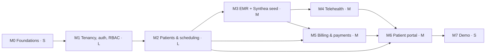

# Development Roadmap — Clinik OS

Status: **approved plan, v1.2.** This is the implementation baseline (ARCHITECTURE §12.5). It is a modular monolith with no Redis and no microservices. v1.2 reduces implementation complexity and leaves functionality unchanged (D11r, D18–D25). Milestones M1–M6 map 1:1 to the six milestones in the project `instruction` doc. M0 (foundations) and M7 (demo) are added.

Sizes are relative (S ≈ 1 week, M ≈ 2 weeks, L ≈ 3 weeks for one developer). They are **estimates, not commitments**: team size and calendar are not specified.

---

## 0. Project acceptance gate (D25)

The project is done when **both** halves pass on a fresh `docker compose up` with seeded data.

### 0.1 The six demo workflows (the product works)

| # | Workflow | Proven in | Must show |
|---|---|---|---|
| WF-1 | A clinic administrator creates a clinic and adds branches and staff | M1 | Platform admin creates the org and the owner accepts the invite. Owner/admin adds 2 branches and invites a manager, doctor and receptionist with branch scopes. Members see only their org |
| WF-2 | A receptionist registers a patient and books an appointment | M2 | Duplicate warning on a near-identical patient. Booking into a free slot. A concurrent second booking of the same slot gets `409 SLOT_TAKEN`. A weekly series is booked. A reminder email arrives (Mailpit) |
| WF-3 | A doctor sees the patient and creates an EMR entry with SOAP, diagnosis and prescription | M3 | Check-in, open encounter, SOAP draft then sign, diagnosis, prescription sign, lab order and result release. Signed note can't be edited, only amended. Synthea history is visible in the chart |
| WF-4 | A doctor and patient hold a video consultation with chat | M4 | Both join the same private room only within the time window. Chat both ways. Doctor drafts and signs a prescription in the side panel |
| WF-5 | The clinic generates an invoice, records an insurance claim and tracks payment | M5 | Invoice from service codes, issue, partial cash payment, claim recorded against the patient's policy, status through to `paid` |
| WF-6 | A patient logs into the portal, views permitted records, books appointments and pays bills | M6 | Self-registration (pending → verified at the desk). Booking. Visit summary, confirmed diagnoses, signed prescriptions and released labs visible, SOAP never visible. Stripe test payment marks the invoice paid via webhook |

These run as Playwright E2E scripts (Stripe and Daily mocked in CI) and once manually against the real sandboxes before the final demo.

### 0.2 Security acceptance suites (the product is safe)

| Suite | Pass condition |
|---|---|
| Tenant isolation | Every tenant route: Org A actor on an Org B id → 404 (route-enumerated) |
| RBAC | Table-driven from RBAC_MATRIX: each role × permission × scope → expected allow / 403 / 404 |
| RLS | `clinic_app` and `clinic_worker` with no context → 0 rows. Cross-tenant writes rejected. Context cleared after COMMIT |
| Clinical integrity | Rules R1–R6 plus the exclusion and composite-FK constraints, one positive and one negative test each |
| Worker | W1–W4 |
| Clinical-read audit | Every clinical GET writes an audit row (route-enumerated) |
| Webhook | Bad signature → 400. Replayed event processed once. Amount mismatch rejected |

---

## 1. Milestone map

M4 and M5 can run in parallel with two developers. Patient login is stubbed in M1, so portal pages can be added incrementally.

**Definition of done (every milestone):**
- migrations reversible;
- OpenAPI updated;
- every new route has `@Require` and is in the RBAC and tenant-isolation suites;
- every integrity rule scheduled for the milestone (§2) has a positive and a negative test;
- every clinical GET is audited (from M3);
- the milestone's demo workflow (§0.1) runs end-to-end;
- CI green.

---

## M0 — Foundations (S)

| Aspect | Content |
|---|---|
| Backend | pnpm monorepo. NestJS app with `main.ts` + `worker.ts`. Config validation (zod). pino logging with redaction + request id. Problem+json error filter. Drizzle + migration runner. Transaction-context helper. `core/jobs`: pg-boss wiring + `runInTenant(orgId, fn)` as the only DB entry point for job code. Health endpoint. OpenAPI generation |
| Database | Extensions. Shared functions `set_updated_at`, `forbid_change_when_frozen`, `forbid_mutation`, `forbid_delete`. Convention: every table migration attaches `set_updated_at`. Roles `clinic_migrator` / `clinic_app` / `clinic_worker` with grants per DATABASE_DESIGN §11.3 |
| API | `GET /api/v1/health` |
| Frontend | Next.js shell, `/api` rewrite, UI primitives, generated API client, TanStack Query |
| Infra | `docker-compose.yml`: postgres, minio, mailpit, api, worker, web. `.env.example`. GitHub Actions CI. dependency-cruiser boundary rules |
| Depends on | — |
| Acceptance | `docker compose up` gives working web + api + worker in under 2 min on a fresh clone. API connects as `clinic_app` and the worker as `clinic_worker`. Neither owns tables |
| Tests | Testcontainers harness that connects as each role. RLS self-check for both roles. **W3** (no context leak after COMMIT). Integrity-test helper that fails on programming errors (SQLSTATE 42xxx except 42501). Boundary-rule violation fails CI |

## M1 — Multi-tenancy, authentication, RBAC (L) · *instruction #1*

| Aspect | Content |
|---|---|
| Backend | identity (argon2id, sessions, login rate limit, reset/verify tokens). tenancy (orgs, branches, members, invitations, role assignments, grant rules). access (≈25 grouped permission strings in `packages/shared`, guard, O/B/Own scope checks, RBAC §3.7). audit writer. platform-admin org provisioning. Mailer + Mailpit |
| Tables | users, sessions, auth_tokens, organizations (INR), branches, organization_members, staff_role_assignments, invitations (staff roles), audit_logs. RLS policies. **Rule R1** |
| API | `/auth/*`, `/admin/organizations*`, `/orgs/:orgId`, `/branches*`, `/members*`, `/invitations*`, `/ownership-transfer`, `/audit-logs` |
| Frontend | Login, accept-invitation, forgot/reset password. Org switcher. Platform admin: org list/create. Org settings, branches, members, invite dialog, role editor. Audit log table |
| Depends on | M0 |
| Acceptance | **Workflow WF-1.** Org A member → 404 on every Org B route. BM cannot grant `branch_manager`. Logout revokes the session immediately. All of it appears in the audit log |
| Tests | Session lifecycle. Lockout. RBAC and tenant-isolation suite scaffolds (route-enumerated). Invitation single-use/expiry. Privilege-escalation negatives. R1. **W1** (least-privilege part: no users, sessions or organizations) |

### M1a — Database and security foundation

The scope is tied to merge commit `01884817ee84f885c2d210b93d6c8582a54e64ba` on `master`.

- Reversible PostgreSQL migrations and a Drizzle schema for users, sessions, auth tokens, organizations, branches, organization members, staff role assignments, staff invitations, and audit logs.
- Tenant keys and composite foreign keys, staff role and invitation scope constraints, one-owner uniqueness, updated-at triggers, forced RLS, current-user membership lookup, runtime role grants, and audit append-only rule R1.
- PostgreSQL integration coverage for migration lifecycle, constraints, grants, and tenant isolation. CI checks the application build, Compose startup, and migration rollback and reapply.

### M1b — Application workflows and acceptance

M1b covers the remaining requirements in §M1.

- Slice 1: identity, sessions, authentication endpoints and initial auth screens.
- Slice 2: tenancy, platform provisioning, organization and branch scope, shared permissions and access guards.
- Slice 3: Own scope, the table-driven RBAC suite and the route-enumerated tenant-isolation suite.
- Slice 4: M1 administration UI and the WF-1 demo.

- Identity with Argon2id passwords, server-side sessions and logout revocation, login throttling and lockout, verification and reset tokens, and email delivery through Mailpit.
- Tenant selection, platform-admin organization provisioning, branch and membership management, staff invitations, role grants, ownership transfer, and application audit writing.
- Shared permissions, request guards, organization and branch scope enforcement, and the M1 auth, organization, branch, member, invitation, ownership-transfer, and audit API routes.
- M1 login, invitation and password screens, organization switcher, platform provisioning screens, organization administration, and audit log UI.
- Session, token and invitation lifecycle checks, the RBAC and tenant-route isolation suites, privilege-escalation negatives, and the WF-1 end-to-end demo.

## M2 — Patients & scheduling (L) · *instruction #2*

| Aspect | Content |
|---|---|
| Backend | patients (registry, MRN from `mrn_seq`, search, **duplicate warning query** on create with `409 POSSIBLE_DUPLICATE` + acknowledge, verification queue, verify, mark-duplicate = inactivate, D19). scheduling (doctor profiles, availability rules/exceptions, slot engine in branch timezone, appointment state machine, weekly/biweekly series all-or-nothing, optimistic locking, **service checks**: doctor-branch assignment, no role removal with future appointments). notifications (outbox + the **only worker job**: discover due → `runInTenant` → send). `core/idempotency` on staff and portal booking (D23) |
| Tables | doctors, patients (verification columns), insurance_policies, availability_rules, availability_exceptions, appointment_series, appointments, notifications, idempotency_keys. Worker discovery policy on notifications |
| API | `/doctors*`, `/availability-*`, `/branches/:id/slots`, `/patients*` (+ `?verification=pending`, `/possible-duplicates`, `/verify`, `/mark-duplicate`), `/insurance-policies*`, `/appointments*` (+ actions), `/appointment-series*` |
| Frontend | Patient search, registration form with possible-duplicate dialog, profile with verification badge. Verification queue (pending records + matches side by side). Doctor availability editor + exceptions. Branch calendar (day/week, per-doctor columns). Booking dialog. Appointment drawer (reschedule/cancel/check-in/no-show). Receptionist "today" view |
| Depends on | M1 |
| Acceptance | **Workflow WF-2.** A weekly series of 6 is created or rejected atomically with conflicts listed. Rescheduling cancels the old reminder. Slots are correct across a DST change. A retried booking with the same key returns the original 201 and creates one row |
| Tests | **20 parallel bookings of one slot → exactly 1 success.** Patient double-booking rejected. Slot engine unit tests (rules, exceptions, bookings, TZ/DST). Series atomicity. State machine. Duplicate warning (each match reason, cross-org never matched). Idempotency (concurrent same key → 1 row + replay, body mismatch → 422). Doctor-branch and role-removal service tests. **W1 (full), W2, W4** (incl. two worker processes). Reminder template has no clinical fields |

## M3 — Electronic medical records + Synthea seed (M) · *instruction #3*

| Aspect | Content |
|---|---|
| Backend | emr (encounter from appointment, SOAP draft/sign/amend versioning, diagnoses ICD-10/SNOMED, allergies, prescriptions draft/sign/cancel with status rules in the service, lab orders → results → release, patient summary write + release). files (presigned upload/download, MIME check). **Clinical-read audit interceptor** on all EMR GET routes (D2). `fhir-import` mappers + **`pnpm seed:synthea --org <slug> <dir>`** (as `clinic_app` through `runInTenant`, one transaction per bundle, `ON CONFLICT DO NOTHING`, summary counts, D18) |
| Tables | encounters, soap_notes, diagnoses, allergies, prescriptions, prescription_items, lab_orders, lab_order_tests, observations, files. **Rules R2, R3, R5 (encounters), R6 (clinical tables)** |
| API | `/patients/:id/chart`, `/encounters*` (+ `/patient-summary`, `/patient-summary/release`), `/soap-note*`, `/diagnoses*`, `/allergies*`, `/prescriptions*`, `/lab-orders*`, `/files*`, `/audit-logs?patientId` |
| Frontend | Patient chart (allergy banner, problems, active meds, labs, encounter timeline). Encounter workspace (SOAP editor with autosave + sign, diagnosis picker from a seeded subset, multi-item Rx form, lab order form). Lab result entry + release. Patient summary editor. Version history. "Who accessed this record" panel (owner/admin) |
| Depends on | M2 |
| Acceptance | **Workflow WF-3.** Only the encounter's doctor can sign or prescribe. Receptionist and owner without the doctor role get 403 on the chart. Seeding the 6 sample bundles creates 6 patients with history, and re-running creates 0 duplicates. A Branch A doctor reads a Branch B-only patient (D2), and the read is logged. Encounter for a pending patient is refused |
| Tests | FHIR mapper unit tests against the sample bundles (counts per resource type, BP component split). Seed idempotency + bad-bundle skip. **R2, R3, R5, R6.** Prescription status-transition service tests. Authorship FK. Lab release gating. Clinical-read audit (route-enumerated). MIME spoofing rejected |

## M4 — Telehealth (M) · *instruction #4*

| Aspect | Content |
|---|---|
| Backend | telehealth (video session auto-created for `video` appointments, service check that the appointment is an active video visit. Daily room created with `privacy: private`, `nbf`, `exp = closes_at`, `eject_at_room_exp = true`, and updated on reschedule. Meeting tokens with participant + time-window checks. End session. Chat via REST, no edit/delete endpoint). Daily client behind an interface. **No cleanup job** (D22) |
| Tables | video_sessions (`expired` derived from `closes_at`), consultation_messages |
| API | `/appointments/:id/video-session`, `/video-sessions/:id`, `/token`, `/end`, `/messages`, `/portal/video-sessions/:id/token`, `/portal/video-sessions/:id/messages` |
| Frontend | Doctor consultation room: Daily Prebuilt iframe + side panel (chart summary, SOAP draft, Rx draft reusing M3 components, chat with 3 s polling). Patient join page: device check, waiting state before `opens_at`, video + chat |
| Depends on | M3 |
| Acceptance | **Workflow WF-4.** Another doctor in the same org → 403 on token. Tokens are room-bound. After `closes_at` the room can't be joined (Daily `exp`) |
| Tests | Token authZ matrix (doctor/patient/other staff/other org). Window boundaries. Reschedule updates `nbf`/`exp`. Room is created with `exp` and `eject_at_room_exp` (contract test on mocked Daily). Video-mode service check. Chat authZ + length. In-call chart reads audited |

## M5 — Billing & payments (M) · *instruction #5*

| Aspect | Content |
|---|---|
| Backend | billing (service codes. Invoice draft → issue with `invoice_number_seq` → void. **No tax** (D11r): `total = subtotal − discount`. Status transitions and "paid never decreases" as service checks. Optional auto-draft on appointment complete (D9). Manual payments. Insurance policies and claims, status recorded manually, claim numbers from `claim_number_seq`). Stripe Checkout (full balance, idempotent). Webhook handler (raw body, signature, `event_id` dedupe, amount/currency/session check against DB; failures return 5xx so Stripe redelivers). Test-key startup guard |
| Tables | service_codes, invoices, invoice_items, payments, insurance_claims, stripe_webhook_events (+ FK `appointments.service_code_id`). **Rules R4, R5 (invoices), R6 (financial tables)** |
| API | `/service-codes*`, `/invoices*` (+ `/issue`, `/void`, `/payments`), `/insurance-claims*` (+ actions), `/webhooks/stripe` |
| Frontend | Service code catalogue. Invoice builder with live totals. Invoice list and detail (payments, claims, void). Record payment dialog. Claims list + status timeline. "Unpaid invoices" widget |
| Depends on | M2, M3 (encounter link optional) |
| Acceptance | **Workflow WF-5.** Issued invoice items and amounts can't change. Partial cash payment gives `partially_paid`, then `paid`. Stripe test payment (Stripe CLI) marks paid **only via webhook**. Replayed webhook has no effect. Tampered signature → 400. A claim can only reference the invoice patient's own policy (DB FK) |
| Tests | Totals (line = qty × price, total = subtotal − discount). **R4, R5, R6.** Status-transition service tests (no void after payment, no paid decrease). Webhook: valid, bad signature, replay, out of order, amount mismatch, unknown session, `livemode=true`. Overpayment flagged. Checkout idempotency. Doctor → 403 on invoices |

## M6 — Patient portal (M) · *instruction #6*

| Aspect | Content |
|---|---|
| Backend | portal facade (patient-scoped queries over patients/scheduling/emr/billing/telehealth). Self-registration per org slug: `pending` record, duplicate warning, identical response with or without a match. Staff invitation links an existing record (also how a duplicate is resolved for the patient, D19). Visibility rules (D5): signed active/completed prescriptions, confirmed diagnoses, released labs, closed-encounter visit summaries, **never SOAP**. Cancellation window (A14). Checkout endpoint. Portal reads audited |
| Tables | patient_accounts. `invitations` with `role='patient'` (already in schema) |
| API | `/portal/*` (ARCHITECTURE §6.2) |
| Frontend | Mobile-first: register/login, "details confirmed at your first visit" notice, profile picker (multi-org), dashboard, booking flow, appointments (cancel, join video), visit history, diagnoses, prescriptions, lab results, bills + Stripe pay |
| Depends on | M2, M3, M4, M5 |
| Acceptance | **Workflow WF-6.** Patient A → 404 on every Patient B resource, same org or not. Cancel inside 24 h refused. Unreleased labs and draft prescriptions hidden. Pages usable at 360 px |
| Tests | Portal authZ (A vs B, same org and cross-org). D5 response-schema snapshot (no SOAP fields). Hidden: provisional/refuted diagnoses, draft/cancelled Rx, unreleased labs and summary. Registration response identical with and without a duplicate. axe accessibility smoke on key pages |

## M7 — Demo (S) · D24

| Aspect | Content |
|---|---|
| Backend | Demo seed: 2 orgs × 2 branches, one user per role, Synthea patients via `seed:synthea`, a few appointments, invoices and claims. Log redaction check |
| Frontend | Empty/error states, loading skeletons, obvious accessibility fixes |
| Depends on | M1–M6 |
| Acceptance | **§0 gate passes:** all six workflows and all security suites green on a fresh clone. One manual run against the real Stripe test mode and Daily. No patient data in logs during the E2E run (automated grep) |
| Post-MVP (not in scope) | OWASP ZAP scan, k6 load test, TOTP MFA (D10), audit-log analytics, partitioning, refunds, SMS, guardians, record merging, in-app FHIR import, Redis |

---

## 2. Integrity rules (DATABASE_DESIGN §10)

All six were smoke-tested against PostgreSQL 16 (DATABASE_DESIGN §13). Each milestone ports its rules to the Testcontainers suite.

| Rule | Trigger(s) | Milestone | Must be rejected | Must succeed |
|---|---|---|---|---|
| — | `<table>_set_updated_at` (mechanical) | M0, attached per table | — | every `updated_at` table has it, and it advances |
| R1 | `audit_logs_append_only` | M1 | UPDATE/DELETE audit row | INSERT |
| R2 | `soap_notes_immutable` | M3 | UPDATE/DELETE signed note | edit draft, insert amendment |
| R3 | `prescriptions_guard`, `prescription_items_guard` | M3 | edit signed fields, delete signed, add/edit items of signed | sign draft, status change, delete draft (cascades), Synthea seed item insert |
| R4 | `invoices_guard`, `invoice_items_guard` | M5 | change amounts or items after issue, delete issued | issue, payment fields, delete draft (cascades) |
| R5 | `encounters_verified_patient`, `invoices_verified_patient` | M3, M5 | encounter/invoice for `pending` patient | verified patient. Imported encounter exempt |
| R6 | `<table>_no_delete` | M3 (clinical), M5 (financial) | DELETE | status change to `entered_in_error` / `void` / `failed` |

Also tested as constraints (not triggers): `appointments_no_doctor_overlap`, `appointments_no_patient_overlap`, `availability_rules_no_overlap`, all composite FKs.
Moved to services in v1.2 (D21), each with a test: doctor-branch assignment (M2), doctor role removal (M2), video-mode check (M4), prescription and invoice status transitions (M3, M5), chat immutability (M4).

## 3. Worker tests (`clinic_worker`, D22)

| # | Test | Milestone |
|---|---|---|
| W1 | **Fail-closed and least privilege:** no tenant context → 0 rows and inserts rejected. No access to users, sessions, patients, SOAP, invoices or video sessions. Cannot change a notification's organization or recipient | M0 (harness), M1, M2 |
| W2 | **Tenant mismatch:** a job running for org A cannot load org B entities or complete org B notifications. It writes nothing and audits `job.tenant_mismatch` | M2 |
| W3 | **No context leak:** context set by job N is gone for job N+1 on the same pooled connection | M0 |
| W4 | **Exactly once:** a claimed notification can't be claimed again. With two worker processes, each reminder is sent once | M2 |

## 4. Test inventory

| Suite | Introduced | Grows in |
|---|---|---|
| Six demo workflows (Playwright) | M1 (WF-1) | one per milestone, through M6 |
| RBAC matrix (table-driven) | M1 | every milestone |
| Tenant isolation (route enumeration) | M1 | every milestone |
| Integrity rules R1–R6 + constraints | M0 helper | M1, M3, M5 |
| Worker W1–W4 | M0 | M1, M2 |
| Clinical-read audit (route enumeration) | M3 | M4, M6 |
| Concurrency (booking, idempotent retries, worker claims) | M2 | M5 (checkout) |
| Webhook security | M5 | — |

## 5. Risks to the schedule

| Risk | Mitigation |
|---|---|
| Infrastructure and edge cases crowd out the six user-facing workflows | §0 gate is workflow-first. v1.2 already removed GST, gapless numbering, relinking, the import pipeline and extra jobs. New scope needs a recorded decision (ARCHITECTURE §12.5) |
| Timezone/DST bugs in the slot engine | Dedicated unit suite in M2. Instants stored, computed in branch TZ with a tested library |
| Daily/Stripe sandbox friction | Interfaces + mocks from day one. Real-sandbox run once in M7 |
| RLS + ORM friction | Prove the transaction-context pattern in M0 before feature work |
| Remaining open defaults (D7–D9, D14, D15) change mid-build | Each is local to one module. Revisit at the start of the milestone that needs it |
| Broad doctor access (D2) challenged later | Scope check isolated in `access.canReadClinicalRecord`. Narrowing is post-MVP (ARCHITECTURE §5) |
| Scope creep (SMS, refunds, guardians, merging, tax, in-app import, Redis, extra services) | Listed as post-MVP in M7. Not built without a new decision |

## Implementation status

Updated on 2026-11-21 for [`anuragrawat0/clinik-os`](https://github.com/anuragrawat0/clinik-os), branch `master`, with local changes based on `3334a7e0a6e9363cab2b7faa9ff9f50ef6faf972`. The original M1a database foundation entered `master` in [`0188481`](https://github.com/anuragrawat0/clinik-os/commit/01884817ee84f885c2d210b93d6c8582a54e64ba). Migration `0003_v12_alignment` completes its v1.2 alignment. The M1b scope follows the remaining requirements in the approved M1 plan.

**Verified** means a relevant check ran and passed in this session. **Implemented-unverified** means implementation evidence exists and the full stated behavior still needs an observed passing check. **Partial** means some requirements are implemented or the implementation differs from the approved design. **Missing** means the required implementation is absent.

### M0 — Foundations

- **Verified** — pnpm workspace with API, web and shared packages. Lint, source formatting, type checking, dependency boundaries and the production build passed. See `pnpm-workspace.yaml`, `package.json` and `dependency-cruiser.config.cjs`.
- **Verified** — NestJS API and worker entry points, Zod startup config, request IDs, generic problem responses and sampled Pino redaction. See `apps/api/src/{main,worker,http-app}.ts`, `core/config`, `core/logging` and `test/http/health.e2e.spec.ts` within the API package.
- **Verified** — PostgreSQL connectivity and startup role checks, Drizzle transactions, clean migration apply/rollback/reapply, four extensions, shared trigger helpers, and the integrity-test helper's SQLSTATE handling. See `database/bootstrap/001-roles.sh`, migration `0001_foundations`, `apps/api/src/core/db`, and the foundation, role and schema-invariant suites in `apps/api/test/db`.
- **Verified** — fail-closed RLS on the foundation test table for both runtime roles, tenant-context checks, and worker pg-boss startup and `runInTenant` isolation. The PostgreSQL tests observed context clearing on a reused connection after commit (v1.2 W3). The full reminder-specific W1, W2 and W4 checks belong to M2.
- **Verified** — `GET /api/v1/health`, OpenAPI generation and the generated TypeScript client. The HTTP tests covered healthy and failed database checks and production Swagger route visibility. Regenerating OpenAPI and the client produced a clean snapshot diff.
- **Verified** — Next.js shell, UI primitive, TanStack Query wiring, and same-origin API rewrite. See `apps/web/src/app`, `apps/web/src/components` and `apps/web/next.config.ts`.
- **Verified** — `.env.example` resolves the Compose configuration. A fresh-volume project started PostgreSQL, ran migrations, and started the API, web, worker, MinIO and Mailpit. The web and direct and proxied API health endpoints responded, MinIO was ready, and the worker reported pg-boss startup. API health recovered after the M1a rollback and reapply.
- **Verified** — local build, test and Compose checks from the GitHub Actions workflow. Historical Actions runs passed `verify` and `compose-smoke` at the [M1a merge](https://github.com/anuragrawat0/clinik-os/actions/runs/44839639514) and [base commit](https://github.com/anuragrawat0/clinik-os/actions/runs/44915746457).
- **Implemented-unverified** — the fresh-clone startup target of under two minutes. **Not run:** a dedicated cold-clone timing check. The isolated smoke run used existing build caches and its build alone took more than two minutes.

### M1a — Database and security foundation

- **Verified** — the schema through `0003_v12_alignment` contains eight identity and tenancy tables plus `audit_logs`. The migration chain, columns, indexes and constraints passed PostgreSQL checks in `apps/api/test/db/{m1a,m1a.independent}.int.spec.ts`. The Drizzle definitions are in `apps/api/src/core/db/schema/m1a.ts` and passed type checking.
- **Verified** — composite membership and branch foreign keys, one-owner uniqueness, organization- and branch-scoped role assignments, staff-only invitation constraints, and the `updated_at` trigger on users, organizations and branches.
- **Verified** — forced RLS on M1 tenant tables, fail-closed ordinary tenant reads and writes, transaction-local context, own-membership and role lookup before organization selection, cross-tenant foreign-key rejection, and denial of worker access to users, sessions, auth tokens and organizations. The foundation checks use the v1.2 labels W1 for fail-closed access and W3 for context clearing.
- **Verified** — R1. The tests observed tenant-scoped audit reads, permitted audit inserts, and rejection of audit updates and deletes via both grants and the append-only trigger.
- **Verified** — v1.2 schema and least-privilege alignment in `0003_v12_alignment`. The tests `removes tenant_counters and keeps only USAGE on existing and default sequence grants` and `reverses and reapplies 0003 sequence grants and rolls back to the unmigrated baseline` verify the public sequences and default ACL. The test `restores the 0002 counter table, forced RLS, and worker grants on 0003 rollback` verifies the restored schema and access. Both runtime roles still insert audit rows with generated IDs. Rollback recreates the counter table empty.

### M1b and later milestones

- M1b and M1 — **Partial**
- Slice 1 identity and sessions — **Verified** (2026-11-22)
- Slice 2 tenancy, provisioning and access core — **Verified** (2026-11-23)
- Slice 3 Own scope and the RBAC and tenant-route suites — **Missing**
- Slice 4 M1 administration UI and WF-1 — **Missing**

### M1b slice 2 checks executed (2026-11-23)

- `pnpm lint`, `pnpm format:check`, `pnpm typecheck`, `pnpm boundary:check`, `pnpm build`, `pnpm audit --prod` and `git diff --check` passed.
- Two consecutive full `pnpm test` runs on the final changes passed 253 tests in 21 files per run. The suites exercised guard order, route declarations, PostgreSQL tenancy and mutation races, and Mailpit delivery with a working invitation. Captured pino output contained no raw invitation token.
- `pnpm api:openapi` and `pnpm api:client` produced byte-identical OpenAPI and client files on their second run.
- GitHub Actions `verify` and `compose-smoke` passed for `41ec759`. [Draft PR #4 CI run](https://github.com/anuragrawat0/clinik-os/actions/runs/45091643579)

### M1b checks executed (2026-11-22)

- `pnpm lint`, `pnpm format:check`, `pnpm typecheck`, `pnpm boundary:check`, `pnpm build`, and `pnpm audit --prod` passed for the review fix-up. Two consecutive full `pnpm test` runs on the final changes passed 218 tests in 20 files each.
- `pnpm api:openapi` and `pnpm api:client` regenerated byte-identical snapshots on a second pass. `git diff --check` passed.
- The existing `compose-smoke` workflow scripts passed under `clinik-smoke` for the review fix-up. A temporary Compose override isolated the subnet and host ports from the existing project. Curl mapped the workflow’s web port 3000 to the isolated web binding at 13000, and the Chromium/Mailpit smoke used Mailpit on 18025. The CI scripts verified web proxy health, the unpublished API port, MinIO, worker startup, and rollback/reapply of `0003_v12_alignment`. The browser smoke passed and the disposable stack was removed.

### Checks executed

- `pnpm lint`, `pnpm format:check`, `pnpm typecheck`, `pnpm boundary:check` and `pnpm build` passed.
- `pnpm test` passed all 84 tests in 12 files, including the 0003 migration tests on PostgreSQL 16.
- `git diff --exit-code -- apps/api/openapi/openapi.json apps/web/src/lib/api-client/schema.d.ts` and `git diff --check` passed.
- The following commands passed under the prefix `docker compose -p clinik-v12-alignment-af3c6233 --env-file .env.example -f docker-compose.yml -f -`. The stdin override used ephemeral loopback ports for the API and web and removed host port mappings for PostgreSQL, MinIO and Mailpit.
  - `config --quiet`, `up --build -d --wait --wait-timeout 120` and `port api 3001`. The API returned `{"status":"ok","database":"ok"}` from `Invoke-RestMethod -Uri http://127.0.0.1:3018/api/v1/health -TimeoutSec 10 -ErrorAction Stop`.
  - `stop api worker web`, `run --rm migrate node dist/core/db/migrate.js down`, `run --rm migrate node dist/core/db/migrate.js up` and `up -d --wait --wait-timeout 120 api worker web`. The migration log identified `0003_v12_alignment` in both directions.
  - `port api 3001` returned the restarted API address. `Invoke-RestMethod -Uri http://127.0.0.1:3026/api/v1/health -TimeoutSec 10 -ErrorAction Stop` again reported a healthy API and database. `down -v` removed the disposable project and volumes.
- **Not run:** `database/tests/reference/smoke3_v12.sql` requires later-milestone tables, starting with `doctors`, outside the checked-out migration set.
- **Not run:** WF-1 and the route-level M1 security checks require the M1b implementation.

### Discrepancies

M1a database discrepancies were resolved by `0003_v12_alignment`.

- D26 (staff invitations), D27 (lockout) and D28 (proxy trust) are now recorded in ARCHITECTURE §11.1. No open architecture discrepancy remains for M1b slice 1.
- The M1a migration names the membership SELECT policy `member_lookup`. DATABASE_DESIGN §11.2 calls the policy `member_scope`. Both allow the actor's membership lookup through the transaction-local user ID.
- After D29 removal, a revoked cookie receives 401 from the session guard. An authenticated requester with the suspended membership receives 404 from the tenant guard.
- ARCHITECTURE §7 describes rotating sessions on privilege changes. Slice 2 applies changed roles on each tenant request and revokes sessions on member removal. Staff role replacement and ownership transfer do not rotate affected users' sessions.
- ARCHITECTURE §6.1 describes action routes for status changes. Slice 2 uses the approved branch status PATCH; organization suspension and reactivation use action routes.
